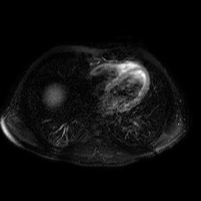
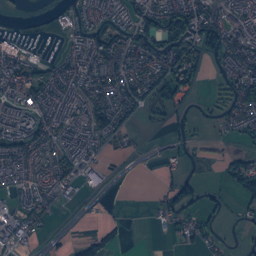

<!-- CL_MOE_VERIFIED_20261021 -->
**CL-MoE正式结果新增：** OneVision完整核验AP42.288、FWT19.039、BWT0.012；相对顺序LoRAAP高2.001分，低于OSFT4.069分。正式完成7/16，最强已完成OneVision仍OSFT；端侧未测留空。[完整结果与核验依据](summary/two_backbone_pct01_20261017/cl_moe_verified_20261021/README.md)。

**结构删减小测完整负结果：** 同一OSFT末态的完整参考、按权重排序半宽、按输入波动排序半宽三组均完成严格重载和独立原评分核验。相同FP16完整包1719.784→1174.587 MiB（少31.701%），加载后RSS约少26%；但5道teacher已见TRAIN探针平均Answer F1为47.089／0／21.754，当前无恢复训练的同时半宽方案不通过，停止自动完整测试。不能称这些通道无用，也不泛化所有压缩无效。[问题、完整结果、结论与行动](summary/edge_deployment_20261019/structured_width_20261020/v1/FINDINGS.md)。这是单轮CPU可行性，不是域测试／独立DEV或最终部署成功，Ours／正式部署列仍空。GPU1原四条件队列与两机基线不变；以下旧执行记录保留为历史。

**2026-10-20 CPU功能空间完整结果：** 同样只保留8个方向，按真实输入拟合的近似比只按权重选择更接近原更新的作用：5个探针平均局部相对误差49.983%→37.326%，240个局部配对中224个降低、16个升高。teacher见过这些训练题；这不是Answer F1、参数可删或端侧收益。[问题、实验结果、结论与下一步](summary/edge_deployment_20261019/cpu_function_space_20261020/v2/FINDINGS.md)。CPU原作业已正常结束，GPU1四组小测继续按原队列等待资源；主表Ours与未测部署项保持空白。下面执行记录保留为历史，以AGENTS顶部为当前状态。

**CPU整模校验通过：** [修复版预定医学校准题](summary/edge_deployment_20261019/cpu_function_space_20261020/v2/README.md)的原／折叠NLL逐值相同，首条校准完成，继续原10题功能对照。不是F1或端侧结果，不将一题校验外推所有输入／GPU。

**CPU修复门槛完成：** [168算子同上下文全部精确](summary/edge_deployment_20261019/cpu_function_space_20261020/v2/repair_gate/VERIFIED_REPAIR.md)，修复版10题模型已实际启动。真实整模NLL门槛与完整功能结果仍待，不是F1或部署收益。

**2026-10-20 测量修复与范围更正：** CPU功能小测v1未通过原模型／折叠NLL精确门槛，原证据保留、无有效探针结果。[独立v2](summary/edge_deployment_20261019/cpu_function_space_20261020/v2/README.md)正在核验同上下文168算子，完整通过后才一次接续原10QA。K59的8.20%等属于无外层autocast系数谱，[不能直接称原前向实际权重谱](summary/edge_deployment_20261019/cpu_update_space_20261020/v1/CONTEXT_SCOPE_CORRECTION.md)。正式基线F1不受本分析修复影响，未取得新质量／部署收益。

**2026-10-20 CPU功能空间小测：** [同rank8比较权重方向与真实输入作用](summary/edge_deployment_20261019/cpu_function_space_20261020/v1/README.md)已实际nohup启动。固定5个校准QA＋5个独立图像组探针、48处q/down；teacher已见这些训练题，本轮不是泛化F1或部署成果。原GPU四组小测和基线不变。

**2026-10-20 CPU系数空间（上下文范围已更正）：** [216个正式最终矩阵的谱分析与两处零训练控制](summary/edge_deployment_20261019/cpu_update_space_20261020/v1/README.md)已完成：OSFT变化平方范数96.67%在q/v之外，每矩阵最佳rank8只保留8.20%总变化；共同q/v投到SeqFT末态切空间保留1.97%，低维各向同性参考1.84%。两处零训练CPU漂移不足实际变化范数0.1%。这些是权重空间事实，不是F1贡献或参数可删证明，不能把OSFT等同普通小LoRA；原四组GPU1小测与两机基线保持。

<!-- FOREVER_V3_PUBLICATION_20261020 -->
**正式基线新结果：** FOREVER／OneVision完整核验AP45.245、FWT17.748、BWT5.642；正式完成7/16组。额外13,952次历史QA曝光／872次回放更新另计，不当作相同训练计算量。[完整证明与回放成本](summary/two_backbone_pct01_20261017/forever_verified_20261020/README.md)。

**当前研究：最强OSFT的额外变动能否轻量复现？** 已实现四组共同小测：原顺序LoRA、原OSFT、普通LoRA覆盖相同七类位置、普通LoRA只更新额外五类位置。冻结1213 FIT／100 DEV（每领域20），从原1313内部按图像／场景留出，不用官方TEST筛选。新唯一队列CPU1154006已接续，GPU1仍他人占用，尚无本轮训练／质量收益；旧六容量自动全测不再运行。[问题、对照、筛选与资源边界](summary/edge_deployment_20261019/osft_increment_screen/v1/README.md)。

**数值条件与公平性：** 停止以浮点／量化精度调整作为方法研究。正式V2公共入口的基座与外层autocast默认FP16，SMoLoRA保留BF16实现例外；各方法还可能包含FP32适配参数或分解因子，参数存储精度不等于计算精度。因此现表不能称所有方法严格同精度，跨例外的成绩差异也不能全部归功于算法。容量消融在各家内部固定原条件：CL三组FP16基座、FP32适配器且其前向禁用autocast；SMo三组BF16基座／autocast、FP32适配器存储。后续方法与对照固定并公开数值条件，质量与部署成本均按同一条件比较；旧精度实验只作工程附录，不计方法贡献。[完整守则](rules/029_numerical_conditions_not_method_contribution_20261019.md)。

**架构扩展必要性：** 已接入CL-MoE／SMoLoRA六组容量消融，分别检验专家分工和总rank是否必要；GPU1仍被他人占用，尚无训练／质量结论。[问题、对照、状态与成本边界](summary/edge_deployment_20261019/architecture_capacity/v1/README.md)。六组是消融，不新增正式基线，主表Ours与未测部署值留空。

**研究问题更正：** 撤回由局部工程试验推导整个领域缺陷的表述；目前尚无兼顾完整质量与端侧优势的新方法。[已证事实、撤回内容及执行修正](summary/edge_deployment_20261019/RESEARCH_RESET_20261019.md)。

**端侧新负例：** 全INT8在五个固定TRAIN请求中丢失了部分原有正确答案，尚不能直接采用；仅压语言也受较大的视觉固定负担限制。[当前方向、论文依据与边界](summary/edge_deployment_20261019/QUANTIZATION_DIRECTION.md)。

**新增TRAIN证据：** 全部1313条已核验；精确重复视图集中于遥感与部分医学，合计可少编码10.79%的视图。该比例不是速度或质量收益。[完整统计与边界](summary/edge_deployment_20261019/train_view_census/v1/VERIFIED_RESULTS.md)。

**端侧研究进展：** 三个正式模型已完成实际导出与独立重载；OSFT和顺序LoRA的常规静态包同大，训练参数少不等于部署更小。下一步从高分OSFT检查视觉重复计算与表示压缩，CPU／GPU平台分别实测。[实验与结论](summary/edge_deployment_20261019/RESEARCH_FINDINGS.md)。目前没有经完整质量确认的部署优势，主表未测项留空。

**目标：个人电脑CPU／GPU及手机端侧部署。** 主表已加入最终部署大小、新增部署大小、CPU峰值RAM、首词延迟、生成速度与常驻适配器数量；未实测留空。[统一测量与一般性问题](summary/edge_deployment_20261019/PROTOCOL.md)。以当前高分完整方法为参照，但只将跨方法／骨干验证的共性问题作为研究结论；所有方法公平地使用常规导出优化。研究仅新GPU1，原科学作业顺序与后台基线保留。

**2026-10-19实际参数比较：** [100%比1%多更新了什么](summary/two_backbone_pct01_20261017/partial_full_vs_pct01_20261019/parameter_geometry/v2/REPORT.md)：六个Qwen检查点的冻结骨干逐字节相同，均为28层q/v、rank8、1,089,536个训练坐标。医学两阶段100%有效更新幅度为1%的17.79／12.93倍，方向余弦0.166／0.030；1%的A/B几乎所有坐标也已改变。自然更新大7.76倍却分数近似，不能将更大更新等同更好效果。框架／起点／样本量与步数仍混杂，不作唯一原因；CPU独立核验完成，不改基线或GPU队列。

**已有100%训练checkpoint的阶段比较：** [Qwen前三阶段与有效1%的完整测试结果](summary/two_backbone_pct01_20261017/partial_full_vs_pct01_20261019/REPORT.md)。自然问答85.817／86.050，医学Modality83.772／40.314，Position65.213／31.380（100%／1%，原始Answer F1）。100%仅完成S1–S3，两版输入与训练框架不同，属于阶段性描述，不填完整主表或声称纯数据量因果。

**更新方式试验（2026-10-19）：** [同一个LoRA功能的尺度控制](summary/onevision_diagnostics_20261016/optimizer_geometry_20261019/v1/RESEARCH_FINDINGS.md)显示，A/B缩放可改变AdamW更新；作者LoRA-RITE消除了本次控制中的差异。新[连续单LoRA候选](summary/onevision_diagnostics_20261016/lora_rite_continuous_20261019/v1/README.md)已排在原训练对照后，尚无GPU／F1结果，不宣称最终低分原因已找到或已有内存优势。

**回放基线已接续（2026-10-19）：** FOREVER双骨干真实训练／保存重载门槛通过，OneVision正式作业已在旧GPU0启动，Qwen在新GPU2队列等待。原基线持续；当前共6条GPU基线作业，完整结果仍4组，FOREVER主表留空。[运行状态与恢复规则](summary/two_backbone_pct01_20261017/forever_multimodal_20261019/v3/README.md)。

**正式基线更新（2026-10-19）：** Qwen2-VL顺序LoRA的恢复分支已通过完整19阶段／74格／21454题核验，AP47.812、FWT13.258、BWT4.415，已填主表；目前4组正式结果完成。[恢复凭据与资源限制](summary/two_backbone_pct01_20261017/qwen_seqft_io_recovery_20261019/README.md)：旧文件保留，中断计算另计，资源日志不完整，不能用来宣称内存优势。

**最新研究进展（2026-10-19）：** [连续系数两组](summary/onevision_diagnostics_20261016/directional_coeff_20261018/v2/REPAIR_FINDINGS.md)都完成19阶段，155题AP20.93／21.72，低于同题顺序LoRA43.36；双完整21454继续，不能宣称提升。[下一项TRAIN-only对照](summary/onevision_diagnostics_20261016/train_update_pilot_20261019/v1/PROTOCOL.md)检查保留当前适配、固定A与提高B更新速度，已排队，尚无GPU结果。正式Ours留空。

**研究重点更新：** 按最新要求先核验数据受限下哪些更新机制有效，暂停预设模块数量；[他人更新方式、已知结果及验证方案](summary/onevision_diagnostics_20261016/DATA_LIMITED_PRIORITY.md)。SVD机制对照v3已实际在GPU1进入初始评测，无新成绩；正式主表口径不变。

**研究接续：** [同20反馈覆盖修正](summary/onevision_diagnostics_20261016/feedback_coverage_20261018/v1/all_six_outcome/RESEARCH_FINDINGS.md)两诊断已完成，AP43.565/43.595对Seq43.363仅小幅点提升。已准入[固定训练参数预算SVD对照v2](summary/onevision_diagnostics_20261016/osft_budget_20261018/v2/queue/README.md)，在真正空闲GPU0/1启动；当前他人占用而等待，不能称已训练。[当前方向](summary/onevision_diagnostics_20261016/DIRECTION_20261018.md)保持小模型／少数据／低资源目标，正式Ours无新结果继续留空。

**研究原因新增：** OSFT的正式优势伴随更强的[刚习得成绩与更大训练容量](summary/onevision_diagnostics_20261016/osft_acquisition_20261018/RESEARCH_FINDINGS.md)，并非相对SeqFT具有更高BWT；不能只按AP归因为防遗忘。新同预算覆盖对照的[TRAIN真实学习核验](summary/onevision_diagnostics_20261016/feedback_coverage_20261018/v1/TRAIN_FIT_FINDINGS.md)已完成，TEST两诊断尚待，正式Ours保持空缺。

# LLMCL：小模型的五领域多模态持续学习

**正式基线新增：** OneVision OSFT已核验完整19阶段／74必要评测格／21454最终QA，AP=46.357、FWT=18.932、BWT=−1.616；SeqFT AP=40.286，差+6.071pp。五域结果已填下方主表。该正式V2结果不能与研究155诊断直接排名；也不能把冷启动局部问题推广成所有既有方法都会变差。[完整核验索引](summary/two_backbone_pct01_20261017/completion_observer_seven_20261018/VERIFIED_INDEX.json)。

**新增发现：** 同域／跨域源的函数补偿均已完成原507题：首步A恢复非零梯度后，F1=15.428／15.533，仍低于完整功能继承18.113／18.468，对应配对图像区间均不含0。不能把冷启动代价全部解释为首步A梯度为0；完整功能复用及正确调用应继续验证。新TRAIN-F1两格已完成诊断，均未取得收益，详见下方。[修订的证明链](summary/onevision_diagnostics_20261016/expert_cold_start_20261018/COLD_START_PROOF.md) · [完整控制与边界](summary/onevision_diagnostics_20261016/function_neutral_init_20261018/v2/function_vs_factor/RESEARCH_FINDINGS.md)。

**当前执行：** 新TRAIN-F1固定匹配与可学习距离两格均完成500NLL／155生成：AP19同为42.860，原顺序43.363，缓存几何45.700。1792维／40步确实更新，但两新格500题路由／NLL及155生成语义字段精确一致；未取得新收益。20锚仅覆盖11／19原生任务，逐题最优相对最佳固定状态的TRAIN空间仅0.144pp。这首先是本次反馈设计的限制，不能推广成1%数据本身无用。[五格完整结果](summary/onevision_diagnostics_20261016/answer_compatibility_20261018/v1/all_five_outcome/RESEARCH_FINDINGS.md) · [真实TRAIN判别空间](summary/onevision_diagnostics_20261016/answer_compatibility_20261018/v1/TRAIN_DECISION_FINDINGS.md)。同20锚覆盖19原生任务的[控制](summary/onevision_diagnostics_20261016/feedback_coverage_20261018/v1/PROTOCOL.md)已实际准入，唯一CPU61499、新GPU0 worker61528先执行原500／155精确门槛，新结果尚待。原数据量case03已正常完成、累计4／18，全部旧任务与完整确认保留。基线继续。

**研究背景：轻量模型、1%数据、低内存增长。** 允许多个LoRA，但以实际领域总Answer F1、AP/FWT/BWT和资源成本评价，不要求每个语言、题型或样本都提升。LoRA是训练参数化，正则化是保护机制，两者可结合；不预设必须扩容或路由。[核心规则](rules/021_lightweight_data_limited_core_20261017.md) · [LoRA与正则化](summary/onevision_diagnostics_20261016/expert_cold_start_20261018/LORA_VS_REGULARIZATION.md)。

**最新执行（2026-10-18）：** 原生连续LoRA＋缓存19阶段/93次更新及四格诊断已完整核验：同155题AP为顺序43.363、缓存几何45.700、缓存质量42.860；域宏差区间均含0，未证大幅稳定提升。相同32道遥感题出现NLL下降而F1下降，质量调用不能直接等同生成质量。[完整四格与边界](summary/onevision_diagnostics_20261016/functional_state_cache_20261018/v1/first_four_view_outcome/RESEARCH_FINDINGS.md)。服务器18:45重启后正式SeqFT接续；CL-MoE保留中断证据后已启动新的独立运行，其他GPU进程保全。[实际执行记录](summary/onevision_diagnostics_20261016/functional_state_cache_20261018/v1/execution_context/README.md)。研究在空闲GPU0/1择一，新机我们的作业最多占三张卡。

**当前主线先保持简单：** [五格来源控制](summary/onevision_diagnostics_20261016/initialization_source_controls_20261018/v1/CONTROL_OUTCOME.md)已全部完成相同26TRAIN／2更新／完整507题：冷启动14.681，同域／跨域全继承18.113／18.468，只继承A并清零B为14.340／14.464。全继承有局部收益；A-only相对冷组区间含0，且源A方向变化较小，不能宣称方向复用无用。额外源12次曝光／2更新另计。[表示与复用的开放方向](rules/023_transfer_compatibility_direction_20261018.md)不锁定LoRA、余弦或线性空间；应学习可迁移关系，不能直接以领域名或语义接近代替复用效果。[三格函数补偿控制](summary/onevision_diagnostics_20261016/function_neutral_init_20261018/v2/PROTOCOL.md)已独立准入，保留源参数、抵消初始旧输出，已全部完成，实际梯度和F1对照见顶部发现。当前新匹配条件继续、所有原任务与基线保留。[实际内存](summary/onevision_diagnostics_20261016/initialization_source_controls_20261018/v1/RESOURCE_SNAPSHOTS.md) · [唯一当前队列](summary/onevision_diagnostics_20261016/answer_compatibility_20261018/v1/queue/README.md)。

[公共V2缓存候选](code/OneVision_FormalStateCache/README.md)的源码、正式SeqFT19阶段小状态和CPU集成已备妥，输入/精度/顺序等与正式框架一致；按最新要求暂后移两个完整确认，不删除。原训练93更新成本仍计入，原生155分数继续只作诊断，正式Ours未完成仍留空。

<!-- FORMAL_MAIN_TABLE_BEGIN -->
## 主实验：双骨干1%多领域持续学习

Acc采用唯一的**Answer F1（0–100）**。训练集为冻结的1%（1313条），测试集为完整21454条；五个数据集按19个原生任务顺序训练，seed=42。空白表示尚无完整核验结果，不能视作0分。

| 方法／Backbone | 类型 | 发表会议／年份 | TextVQA 自然／通用 | SLAKE 医学 | RSVQA-LR 遥感 | FinMME 金融 | CODA-LM 交通 | AP ↑ | FWT ↑ | BWT ↑ | 最终部署 MiB ↓ | 新增部署 MiB ↓ | 推理峰值内存 CPU RAM／GPU VRAM MiB ↓ | 首词延迟 CPU／GPU s ↓ | 生成速度 CPU／GPU tok/s ↑ | 常驻适配器 数量 ↓ |
| --- | --- | --- | ---: | ---: | ---: | ---: | ---: | ---: | ---: | ---: | ---: | ---: | ---: | ---: | ---: | ---: |
| **Qwen2-VL-2B-Instruct** |  |  |  |  |  |  |  |  |  |  |  |  |  |  |  |  |
| SeqFT-LoRA | 朴素顺序微调 | 标准对照（无独立发表年份） | 86.312 | 47.654 | 51.110 | 26.576 | 33.210 | 47.812 | 13.258 | 4.415 |  |  |  |  |  |  |
| FOREVER | 回放 | [ACL 2026](https://aclanthology.org/2026.acl-long.1144/) |  |  |  |  |  |  |  |  |  |  |  |  |  |  |
| CL-MoE | 架构 | [CVPR 2025](https://openaccess.thecvf.com/content/CVPR2025/html/Huai_CL-MoE_Enhancing_Multimodal_Large_Language_Model_with_Dual_Momentum_Mixture-of-Experts_CVPR_2025_paper.html) |  |  |  |  |  |  |  |  |  |  |  |  |  |  |
| SMoLoRA | 架构 | [ICCV 2025](https://openaccess.thecvf.com/content/ICCV2025/html/Wang_SMoLoRA_Exploring_and_Defying_Dual_Catastrophic_Forgetting_in_Continual_Visual_ICCV_2025_paper.html) |  |  |  |  |  |  |  |  |  |  |  |  |  |  |
| PASs-MoE | 架构（兼正则） | [ACL 2026](https://aclanthology.org/2026.acl-long.1474/) |  |  |  |  |  |  |  |  |  |  |  |  |  |  |
| PaRSP | 正则化 | [ACL 2026](https://aclanthology.org/2026.acl-long.1244/) |  |  |  |  |  |  |  |  |  |  |  |  |  |  |
| OSFT | 正则化 | [ICLR 2026](https://proceedings.iclr.cc/paper_files/paper/2026/hash/22620cccae29bbb3f18d226ea0320ff5-Abstract-Conference.html) |  |  |  |  |  |  |  |  |  |  |  |  |  |  |
| SpaRTA | 正则化 | [ACL 2026](https://aclanthology.org/2026.acl-long.334/) |  |  |  |  |  |  |  |  |  |  |  |  |  |  |
| Ours | 自研方法 | 未发表 |  |  |  |  |  |  |  |  |  |  |  |  |  |  |
| **LLaVA-OneVision-Qwen2-0.5B-OV** |  |  |  |  |  |  |  |  |  |  |  |  |  |  |  |  |
| SeqFT-LoRA | 朴素顺序微调 | 标准对照（无独立发表年份） | 75.632 | 40.758 | 46.711 | 15.891 | 31.938 | 40.286 | 14.783 | 1.775 |  |  |  |  |  |  |
| FOREVER | 回放 | [ACL 2026](https://aclanthology.org/2026.acl-long.1144/) | 64.486 | 46.103 | 50.570 | 9.623 | 33.370 | 45.245 | 17.748 | 5.642 |  |  |  |  |  |  |
| CL-MoE | 架构 | [CVPR 2025](https://openaccess.thecvf.com/content/CVPR2025/html/Huai_CL-MoE_Enhancing_Multimodal_Large_Language_Model_with_Dual_Momentum_Mixture-of-Experts_CVPR_2025_paper.html) | 74.657 | 41.139 | 50.050 | 14.914 | 33.110 | 42.288 | 19.039 | 0.012 |  |  |  |  |  |  |
| SMoLoRA | 架构 | [ICCV 2025](https://openaccess.thecvf.com/content/ICCV2025/html/Wang_SMoLoRA_Exploring_and_Defying_Dual_Catastrophic_Forgetting_in_Continual_Visual_ICCV_2025_paper.html) |  |  |  |  |  |  |  |  |  |  |  |  |  |  |
| PASs-MoE | 架构（兼正则） | [ACL 2026](https://aclanthology.org/2026.acl-long.1474/) |  |  |  |  |  |  |  |  |  |  |  |  |  |  |
| PaRSP | 正则化 | [ACL 2026](https://aclanthology.org/2026.acl-long.1244/) | 73.346 | 38.743 | 54.088 | 20.609 | 32.655 | 40.390 | 18.503 | -0.484 |  |  |  |  |  |  |
| OSFT | 正则化 | [ICLR 2026](https://proceedings.iclr.cc/paper_files/paper/2026/hash/22620cccae29bbb3f18d226ea0320ff5-Abstract-Conference.html) | 73.907 | 43.894 | 51.709 | 23.982 | 36.196 | 46.357 | 18.932 | -1.616 |  |  |  |  |  |  |
| SpaRTA | 正则化 | [ACL 2026](https://aclanthology.org/2026.acl-long.334/) | 73.596 | 40.921 | 45.942 | 21.328 | 34.520 | 41.829 | 17.145 | -2.992 |  |  |  |  |  |  |
| Ours | 自研方法 | 未发表 |  |  |  |  |  |  |  |  |  |  |  |  |  |  |

五个数据集列为训练结束后的完整域内QA平均F1；AP为19个原生任务等权平均，FWT/BWT按已测的必要阶段计算。两种权重口径不同。[FOREVER（ACL 2026）正式运行](summary/two_backbone_pct01_20261017/forever_multimodal_20261019/v3/README.md)已通过双骨干模型／保存重载门槛；OneVision已通过完整19阶段／74格／21454题及回放成本核验，Qwen仍等待原基线后的空闲GPU2；Ours尚无可填入此正式表的完整结果。ER-LoRA已按用户要求移出比较，已有结果保留在历史证据中。

类型按主要抗遗忘机制归类，PASs-MoE兼有正则化；LoRA是参数化方式，不单独作为上述方法类型。会议链接指向正式发表页，年份按会议届次。

[方法分类、发表信息及状态](summary/two_backbone_pct01_20261017/BASELINES.md) · [完整主表与协议](summary/two_backbone_pct01_20261017/MAIN_TABLE.md) · [逐题核验索引](summary/two_backbone_pct01_20261017/completion_observer_seven_20261018/VERIFIED_INDEX.json) · [FOREVER额外完整核验](summary/two_backbone_pct01_20261017/forever_verified_20261020/README.md)

<!-- CPU_EDGE_METRICS_NOTE -->
端侧部署包括**个人电脑CPU／独立GPU及手机**。最终部署大小包含基座、视觉编码器、投影和全部必需适配器／专家／路由／索引；新增部署大小为同格式、同精度下最终包减初始包。训练优化器、日志和历史checkpoint不计入部署包。参数值更新不等于参数量增加，可折叠更新按实际导出后大小计量。CPU RAM与GPU显存分别报告，延迟与速度注明CPU／GPU设备档；方法对比须使用相同设备、线程、精度、输入及生成预算。服务器CPU及服务器安装的消费级GPU须标明实际整机环境，不能称手机实测。当前部署列均未实测，保持空白。量化／剪枝等改变模型输出的部署版本须单列并验证其Answer F1。 [指标与一般性问题协议](summary/edge_deployment_20261019/PROTOCOL.md)。
<!-- CPU_EDGE_METRICS_NOTE_END -->

<!-- FORMAL_MAIN_TABLE_END -->

## 当前实验与阅读入口

| 入口 | 内容与边界 |
| --- | --- |
| [正式双骨干主表](summary/two_backbone_pct01_20261017/MAIN_TABLE.md) | Qwen2-VL-2B与OneVision 0.5B分块，五领域最终分数、AP/FWT/BWT。只填完整核验结果；[只读发布器](summary/two_backbone_pct01_20261017/completion_observer_seven_20261018/README.md)覆盖原14个组合，FOREVER双骨干已独立准入；共16个目标中6组完整核验，未完成格留空。 |
| [正式V2框架与公平性](summary/two_backbone_native_cl_20261017_v2/README.md) | 两机共享TRAIN/TEST ID、原生任务顺序、方法代码、预算、公共图像输入与评分；原生processor/tokenizer因骨干而异。旧零LR/V1结果隔离。 |
| [当前两模块源码索引](code/OneVision_ColdStartQuality/README.md) | A完整继承+B TRAIN质量调用；源文件、实际包装器、四格协议和证据入口。与早期位移保护原型分开，不混结果。 |
| [问题发现总报告](summary/onevision_diagnostics_20261016/RESEARCH_REPORT.md) | 按问题、实验、结果、证明、改进、效果记录；区分已证实、已反驳、未解决。[关键发现](summary/onevision_diagnostics_20261016/KEY_FINDINGS.md)提供证据索引。 |
| [两模块四格诊断](summary/onevision_diagnostics_20261016/warm_quality_20261018/predeclared_hard_case/RESEARCH_FINDINGS.md) | 同155题四格与SeqFT逐题比较；点优势小且域宏差区间含0，完整21454待。 |
| [研究诊断表](summary/onevision_diagnostics_20261016/functional_router/MAIN_TABLE_DIAGNOSTIC.md) | 原生AnyRes/BF16、同155题的六方法对照；不能混入正式V2或当完整21454题结果。 |
| [唯一研究队列](summary/onevision_diagnostics_20261016/lora_rite_continuous_20261019/v1/queue/README.md) | 当前GPU自然完成后先原TRAIN-only更新对照，再连续LoRA-RITE训练与完整确认，随后全部原工作；实际queue_state与PID优先。 |
| [文献问题与启发](summary/onevision_diagnostics_20261016/LITERATURE_PROBLEMS.md) | 他人发现、验证角度、解决方式及适用边界；不是本模型已证实原因。 |

2026-10-18运行快照：研究仅新GPU1。原质量硬调用完整确认因FinMME:5082辅助特征缺id的日志异常停止，旧预测和失败证据保留；[新实现修复与实际GPU门禁](summary/onevision_diagnostics_20261016/feature_identity_repair_20261018/README.md)已通过。温启动19阶段与500NLL/155生成已封存，AP+4.000；温池四视图已实际启动GPU415408，接续全部18数据量控制，再从头重测完整确认；全部其余既定实验保留。两机正式基线继续，新GPU0保留；完整四格收益仍待。

当前温池质量头已用43历史TRAIN/172次NLL前向完成400次CPU更新，16参数确实改变；这不是Answer F1。评测期间新增外部GPU1作业，已[记录共享设备上下文](summary/onevision_diagnostics_20261016/warm_quality_20261018/execution_context/FOREIGN_GPU_OVERLAP_20261018.json)，当前评测继续、后续待实际空闲；共享时段耗时不作为方法速度优势。

当前预定A+B硬调用条件的500NLL/155生成已核验：AP44.165，较同题原生SeqFT43.363高0.803；域宏平均+0.923、95%区间[-0.760,2.872]含0。它恢复弱冷池，但尚未确立稳定/大幅超过简单基线。见[四格、五域、对照与成本](summary/onevision_diagnostics_20261016/warm_quality_20261018/predeclared_hard_case/RESEARCH_FINDINGS.md)。全部辅助视图现已封存；完整21454及正式表Ours仍待。

已从完成的SeqFT-LoRA、PaRSP完整预测中取出相同155题重算：[已完成基线与A＋B同题比较](summary/onevision_diagnostics_20261016/warm_quality_20261018/completed_baseline_comparison/EVIDENCE.md)。诊断AP分别为41.570、37.401，研究A＋B为44.165；研究AnyRes/BF16与正式V2图像预算/FP16有差异，不能据此宣称公平胜出。PaRSP在155题与完整测试的相对名次不同，正式主表仍只填完整核验结果。

## 研究成果：已知什么，尚缺什么

新增[模块输入控制](summary/onevision_diagnostics_20261016/functional_router/input_dependence_20261018/RESEARCH_FINDINGS.md)曾提示A/B可能重叠；新四格诊断已观察到B在温池仍有+9.140 AP增量。完整收益和统计互补性仍待，不把两个局部收益相加。

**方法开发：** [两个问题、两个模块与四格消融](summary/onevision_diagnostics_20261016/warm_quality_20261018/PROBLEM_AND_METHOD.md)：A继承完整旧适配，B用TRAIN质量校准调用。固定池诊断支持调用贡献，但组合入口已准入自动调度，温启动父池已封存、诊断AP31.025→35.025，预定质量硬调用诊断AP44.165已完成，其余视图已封存、完整21454仍待。

新增[实际首步梯度对照](summary/onevision_diagnostics_20261016/expert_cold_start_20261018/first_factor_gradient/RESEARCH_FINDINGS.md)：同11TRAIN/一步，冷启动48层A均未更新，完整继承后48层A均更新。完整继承同时改变旧功能与优化通道；不能全归旧知识，也不是新增F1。温启动19阶段/155诊断已完成；完整21454及稳定大幅收益仍待。

[模块A的完整19阶段对照](summary/onevision_diagnostics_20261016/warm_start_20261018/first19_outcome/RESEARCH_FINDINGS.md)已完成：同155题诊断AP31.025→35.025、医学F1 15.841→25.339，另外四域答案不变；500条调用精确一致。支持初始化贡献，但仅A仍低于同诊断SeqFT 43.363；B在温池的诊断增量+9.140已取得，完整21454及大幅提升目标仍待。

**后续主线：新LoRA冷启动与弱习得。** 独立[证明过程与下一步判据](summary/onevision_diagnostics_20261016/expert_cold_start_20261018/COLD_START_PROOF.md)串联真实分配、权重不变与初始化干预；已支持一个少数据任务的局部继承收益，完整流程及数据量交互待测。

下表分数均为 Answer F1（越高越好）；小规模诊断的结论仅适用于对应实验。

| 探究的问题 | 做了什么实验，结果是什么 | 结论 |
| --- | --- | --- |
| 方法排名会受平均方式影响吗？ | 对同一批完整测试结果重新汇总：回放比顺序训练的任务平均分低1.01分，领域平均分却高0.77分。[证据](summary/onevision_diagnostics_20261016/v2_aggregation_20261018/RESEARCH_FINDINGS.md) | 平均方式会改变排名；比较时必须统一口径。 |
| 低分是没学好，还是后来忘了？ | 增加训练更新：医学任务从29.26升至51.96，遥感任务却从76降至44。[证据](summary/onevision_diagnostics_20261016/RESEARCH_REPORT.md) | 初次学习不足也是问题；增加训练并非总有效。 |
| 少数据下，新建LoRA是否不如继承已有LoRA？ | 同样用11条医学问答训练一次，完整228题测试：从头训练19.88，继承已有LoRA后29.26；原新LoRA此后没有被修改。[证据](summary/onevision_diagnostics_20261016/expert_cold_start_20261018/RESEARCH_FINDINGS.md) | 本例从头训练就没学好；继承已有适配提高9.39分。 |
| 跨领域训练后的差距都是遗忘吗？ | 同一医学任务学完为20.36分；继续学同领域后34.17，改学其他领域后18.63。[证据](summary/onevision_diagnostics_20261016/RESEARCH_REPORT.md) | 差距也包含同领域训练的帮助，不能全部算作遗忘。 |
| 按输入相似度选择LoRA，能选对吗？ | 在同155题上比较选择方式：固定相似度22.39、学习相似度31.03、依据训练题答题质量选择36.70；顺序训练单LoRA为43.36。[证据](summary/onevision_diagnostics_20261016/functional_router/PILOT_FINDINGS_20261018.md) | 输入相近不保证回答好；这几种选择方式仍未超过简单基线。 |
| 同样已有LoRA功能，更新还会受参数写法影响吗？ | 三个任务真实训练梯度保持B×A不变；A放大4倍后，AdamW权重更新约为原来的4倍，作者RITE更新相同。[证据](summary/onevision_diagnostics_20261016/optimizer_geometry_20261019/v1/RESEARCH_FINDINGS.md) | 更新几何确实可干预；最终Answer F1与实际资源效果待测。 |
| 补充专业知识就能提高问答表现吗？ | 让模型学习16条专业事实：能记住这些事实，但相关医学问答未稳定改善。[证据](summary/onevision_diagnostics_20261016/RESEARCH_REPORT.md) | 记住知识不等于能在目标问题中用好知识。 |
| 更新次数很少时，保护旧知识的约束会生效吗？ | 检查PASs-MoE：9个只更新一次的阶段中，一项保护系数始终为0；另验得EWC以当前参数为保护中心时，第一步保护梯度为0。[证据](summary/onevision_diagnostics_20261016/regularizer_budget_20261018/RESEARCH_FINDINGS.md) | 少量更新可能让部分保护机制来不及发挥作用，尚未证明会降低最终分数。 |
| 专家选择器真的在学习吗？ | 对SMoLoRA原代码做梯度检查：两个选择器没有收到梯度，专家本身正常更新；不更新选择器也能随输入切换专家。[证据](summary/onevision_diagnostics_20261016/smolora_gate_20261018/RESEARCH_FINDINGS.md) | 本次代码检查中，选择发生变化不代表选择器学会了；尚无性能因果结论。 |
| 训练参数少，就一定省内存吗？ | 核对资源统计：除训练参数外，冻结专家、优化器、缓存和临时候选也占内存；尚无同条件下更省内存的完整对照。[口径](rules/021_lightweight_data_limited_core_20261017.md) | 参数少不等于内存低；当前尚未证明内存优势。 |

原生AnyRes单LoRA参考已完成21454题：自然75.917、医学40.943、遥感49.010、金融12.991、交通31.916，19任务AP41.361；完整FWT/BWT仍缺阶段格，不能从最终分数补算。[完整结果](summary/onevision_diagnostics_20261016/full_confirmation_evidence/CAP1_COMPLETION.md)。

[仅改变新专家初始化的19阶段控制](summary/onevision_diagnostics_20261016/warm_start_20261018/PROTOCOL.md)与[独特TRAIN量×初始化×更新的18轨迹控制](summary/onevision_diagnostics_20261016/cold_data_factorial_20261018/PROTOCOL.md)已冻结并准入，GPU结果待测；CPU机制检查不算模型效果。已有[严格同起点/首批梯度](summary/onevision_diagnostics_20261016/matched_task_domain/first_transition_geometry/VERIFIED_RESULTS.md)、[重复任务六控制](summary/onevision_diagnostics_20261016/matched_task_domain/repeat_control_evidence/T04_VERIFIED_RESULTS.md)、[实际回放覆盖](summary/onevision_diagnostics_20261016/matched_task_domain/replay_exposure/VERIFIED_RESULTS.md)等证据继续保留。

## 方法 × 方向二维表

已整理 **29 篇** 2024–2026 年正式会议论文：持续预训练 6 篇、持续微调 20 篇、持续对齐 3 篇。各方向列直接列出方法名，持续微调细分回放、正则化和架构；列内优先较新论文，同年优先 CVPR／ICCV。横向同一行的方法之间没有对应关系。点击方法名进入正式论文页，点击 PDF 查看仓库文件。年份按正式会议届次；逐篇核验记录见 [paper/verification_audit.md](paper/verification_audit.md)。

<table>
<thead>
<tr><th rowspan="2">持续预训练</th><th colspan="3">持续微调</th><th rowspan="2">持续对齐</th></tr>
<tr><th>基于回放</th><th>基于正则化</th><th>基于架构</th></tr>
</thead>
<tbody>
<tr><td><a href="https://aclanthology.org/2026.acl-long.427/" title="Data Mixing Agent: Learning to Re-weight Domains for Continual Pre-training"><strong>Data Mixing Agent</strong></a> ACL 2026 <a href="paper/pre_training/2026_ACL_Data_Mixing_Agent.pdf">PDF</a></td><td><a href="https://openaccess.thecvf.com/content/CVPR2026/html/Gao_Re-evaluating_Continual_VQA_Toward_Fair_and_Robust_Evaluation_for_Multimodal_CVPR_2026_paper.html" title="Re-evaluating Continual VQA: Toward Fair and Robust Evaluation for Multimodal Continual Learning"><strong>MaDQ / UCo-VQA</strong></a> CVPR 2026 <a href="paper/pre_finetuning/method_replay/2026_CVPR_MaDQ_UCo_VQA.pdf">PDF</a></td><td><a href="https://openaccess.thecvf.com/content/CVPR2026/html/Li_Multimodal_Continual_Instruction_Tuning_with_Dynamic_Gradient_Guidance_CVPR_2026_paper.html" title="Multimodal Continual Instruction Tuning with Dynamic Gradient Guidance"><strong>DGG</strong></a> CVPR 2026 <a href="paper/pre_finetuning/method_regularization/2026_CVPR_DGG.pdf">PDF</a></td><td><a href="https://aclanthology.org/2026.acl-long.1474/" title="PASs-MoE: Mitigating Misaligned Co-drift among Router and Experts via Pathway Activation Subspaces for Continual Learning"><strong>PASs-MoE</strong></a> ACL 2026 <a href="paper/pre_finetuning/method_architecture/2026_ACL_PASs_MoE.pdf">PDF</a></td><td><a href="https://openaccess.thecvf.com/content/CVPR2026/html/Wang_Harmonious_Parameter_Adaptation_in_Continual_Visual_Instruction_Tuning_for_Safety-Aligned_CVPR_2026_paper.html" title="Harmonious Parameter Adaptation in Continual Visual Instruction Tuning for Safety-Aligned MLLMs"><strong>HPA</strong></a> CVPR 2026 <a href="paper/pre_alignment/2026_CVPR_HPA.pdf">PDF</a></td></tr>
<tr><td><a href="https://aclanthology.org/2026.acl-long.1722/" title="Glyph: Scaling Context Windows via Visual-Text Compression"><strong>Glyph</strong></a> ACL 2026 <a href="paper/pre_training/2026_ACL_Glyph.pdf">PDF</a></td><td><a href="https://aclanthology.org/2026.acl-long.1144/" title="FOREVER: Forgetting Curve-Inspired Memory Replay for Language Model Continual Learning"><strong>FOREVER</strong></a> ACL 2026 <a href="paper/pre_finetuning/method_replay/2026_ACL_FOREVER.pdf">PDF</a></td><td><a href="https://aclanthology.org/2026.acl-long.1244/" title="Harmonizing the Past, Present, and Future: A Null-Space Constrained Region-Specific Method for Continual Learning in LLMs"><strong>PaRSP</strong></a> ACL 2026 <a href="paper/pre_finetuning/method_regularization/2026_ACL_PaRSP.pdf">PDF</a></td><td><a href="https://proceedings.iclr.cc/paper_files/paper/2026/hash/0dedca10992d34035c9a9776254cfa8c-Abstract-Conference.html" title="Merge before Forget: A Single LoRA Continual Learning via Continual Merging"><strong>SLAO / Merge before Forget</strong></a> ICLR 2026 <a href="paper/pre_finetuning/method_architecture/2026_ICLR_SLAO_Merge_before_Forget.pdf">PDF</a></td><td><a href="https://ojs.aaai.org/index.php/AAAI/article/view/40428" title="LifeAlign: Lifelong Alignment for Large Language Models with Memory-Augmented Focalized Preference Optimization"><strong>LifeAlign</strong></a> AAAI 2026 <a href="paper/pre_alignment/2026_AAAI_LifeAlign.pdf">PDF</a>（作者扩展版）</td></tr>
<tr><td><a href="https://aclanthology.org/2026.acl-long.1866/" title="From Curated Data to Scalable Models: Continual Pre-training of Dense and MoE Large Language Models for Tibetan"><strong>Tibetan Dense / MoE CPT</strong></a> ACL 2026 <a href="paper/pre_training/2026_ACL_Tibetan_Dense_MoE_CPT.pdf">PDF</a></td><td><a href="https://proceedings.iclr.cc/paper_files/paper/2026/hash/17fc58b1ba92abbb72c5f457e140d851-Abstract-Conference.html" title="Forget Forgetting: Continual Learning in a World of Abundant Memory"><strong>Weight Space Consolidation</strong></a> ICLR 2026 <a href="paper/pre_finetuning/method_replay/2026_ICLR_Weight_Space_Consolidation.pdf">PDF</a></td><td><a href="https://aclanthology.org/2026.acl-long.334/" title="Spectral Disentanglement: Rank-Aware Task Adaptation for Rehearsal-free Continual Learning in LLMs"><strong>SpaRTA</strong></a> ACL 2026 <a href="paper/pre_finetuning/method_regularization/2026_ACL_SpaRTA.pdf">PDF</a></td><td><a href="https://proceedings.mlr.press/v306/wang26le.html" title="CoPE: Continual Probe-guided Expansion for Large Vision-Language Models"><strong>CoPE</strong></a> ICML 2026 <a href="paper/pre_finetuning/method_architecture/2026_ICML_CoPE.pdf">PDF</a></td><td><a href="https://proceedings.iclr.cc/paper_files/paper/2024/hash/6246f93ebf4f2d76ad2bcb3158220d34-Abstract-Conference.html" title="CPPO: Continual Learning for Reinforcement Learning with Human Feedback"><strong>CPPO</strong></a> ICLR 2024 <a href="paper/pre_alignment/2024_ICLR_CPPO.pdf">PDF</a></td></tr>
<tr><td><a href="https://proceedings.iclr.cc/paper_files/paper/2026/hash/528f0a943a54903939e77509f874d8e8-Abstract-Conference.html" title="Cite Pretrain: Retrieval-Free Knowledge Attribution for Large Language Models"><strong>Cite Pretrain / Active Indexing</strong></a> ICLR 2026 <a href="paper/pre_training/2026_ICLR_Cite_Pretrain_Active_Indexing.pdf">PDF</a></td><td><a href="https://proceedings.neurips.cc/paper_files/paper/2025/hash/087b346ca4d6dd6fcd0663ff6c9a6b69-Abstract-Conference.html" title="Self-Evolving Pseudo-Rehearsal for Catastrophic Forgetting with Task Similarity in LLMs"><strong>SERS</strong></a> NeurIPS 2025 <a href="paper/pre_finetuning/method_replay/2025_NeurIPS_SERS.pdf">PDF</a></td><td><a href="https://proceedings.iclr.cc/paper_files/paper/2026/hash/22620cccae29bbb3f18d226ea0320ff5-Abstract-Conference.html" title="Sculpting Subspaces: Constrained Full Fine-Tuning in LLMs for Continual Learning"><strong>OSFT</strong></a> ICLR 2026 <a href="paper/pre_finetuning/method_regularization/2026_ICLR_OSFT.pdf">PDF</a></td><td><a href="https://proceedings.mlr.press/v306/kong26h.html" title="ECA: Efficient Continual Alignment for Open-Ended Image-to-Text Generation"><strong>ECA</strong></a> ICML 2026 <a href="paper/pre_finetuning/method_architecture/2026_ICML_ECA.pdf">PDF</a></td><td></td></tr>
<tr><td><a href="https://proceedings.mlr.press/v306/padmanabhan26a.html" title="Updating Parametric Knowledge with Context Distillation Retains Post-Training Capabilities"><strong>DiSC</strong></a> ICML 2026 <a href="paper/pre_training/2026_ICML_DiSC.pdf">PDF</a></td><td></td><td><a href="https://proceedings.mlr.press/v306/xia26j.html" title="Adversarial Latent Embedding Repair for LLM Continual Learning"><strong>ALER</strong></a> ICML 2026 <a href="paper/pre_finetuning/method_regularization/2026_ICML_ALER.pdf">PDF</a></td><td><a href="https://proceedings.mlr.press/v306/xu26cj.html" title="Hyper-LLaVA: Hyperbolic Uncertainty-aware Modality-Balanced Routing for Multimodal Continual Instruction Tuning"><strong>Hyper-LLaVA（本轮移出）</strong></a> ICML 2026 <a href="paper/pre_finetuning/method_architecture/2026_ICML_Hyper_LLaVA.pdf">PDF</a></td><td></td></tr>
<tr><td><a href="https://proceedings.mlr.press/v306/borodin26a.html" title="Diffract: Spectral View of LLM Domain Adaptation"><strong>Diffract</strong></a> ICML 2026 <a href="paper/pre_training/2026_ICML_Diffract.pdf">PDF</a></td><td></td><td><a href="https://proceedings.iclr.cc/paper_files/paper/2025/hash/74fc5575632191d96881d8015f79dde3-Abstract-Conference.html" title="Unlocking the Power of Function Vectors for Characterizing and Mitigating Catastrophic Forgetting in Continual Instruction Tuning"><strong>FV-guided Training</strong></a> ICLR 2025 <a href="paper/pre_finetuning/method_regularization/2025_ICLR_FV_guided_Training.pdf">PDF</a></td><td><a href="https://openaccess.thecvf.com/content/CVPR2025/html/Huai_CL-MoE_Enhancing_Multimodal_Large_Language_Model_with_Dual_Momentum_Mixture-of-Experts_CVPR_2025_paper.html" title="CL-MoE: Enhancing Multimodal Large Language Model with Dual Momentum Mixture-of-Experts for Continual Visual Question Answering"><strong>CL-MoE（本轮新增，多模态）</strong></a> CVPR 2025 <a href="paper/pre_finetuning/method_architecture/2025_CVPR_CL_MoE.pdf">PDF</a></td><td></td></tr>
<tr><td></td><td></td><td></td><td><a href="https://openaccess.thecvf.com/content/ICCV2025/html/Tong_Any-SSR_How_Recursive_Least_Squares_Works_in_Continual_Learning_of_ICCV_2025_paper.html" title="Any-SSR: How Recursive Least Squares Works in Continual Learning of Large Language Model"><strong>Any-SSR</strong></a> ICCV 2025 <a href="paper/pre_finetuning/method_architecture/2025_ICCV_Any_SSR.pdf">PDF</a></td><td></td></tr>
<tr><td></td><td></td><td></td><td><a href="https://openaccess.thecvf.com/content/ICCV2025/html/Guo_Federated_Continual_Instruction_Tuning_ICCV_2025_paper.html" title="Federated Continual Instruction Tuning"><strong>FCIT</strong></a> ICCV 2025 <a href="paper/pre_finetuning/method_architecture/2025_ICCV_FCIT.pdf">PDF</a></td><td></td></tr>
<tr><td></td><td></td><td></td><td><a href="https://openaccess.thecvf.com/content/ICCV2025/html/Jin_Instruction-Grounded_Visual_Projectors_for_Continual_Learning_of_Generative_Vision-Language_Models_ICCV_2025_paper.html" title="Instruction-Grounded Visual Projectors for Continual Learning of Generative Vision-Language Models"><strong>MVP / Instruction-Grounded Visual Projectors</strong></a> ICCV 2025 <a href="paper/pre_finetuning/method_architecture/2025_ICCV_MVP_Instruction_Grounded_Visual_Projectors.pdf">PDF</a></td><td></td></tr>
<tr><td></td><td></td><td></td><td><a href="https://openaccess.thecvf.com/content/ICCV2025/html/Wang_SMoLoRA_Exploring_and_Defying_Dual_Catastrophic_Forgetting_in_Continual_Visual_ICCV_2025_paper.html" title="SMoLoRA: Exploring and Defying Dual Catastrophic Forgetting in Continual Visual Instruction Tuning"><strong>SMoLoRA</strong></a> ICCV 2025 <a href="paper/pre_finetuning/method_architecture/2025_ICCV_SMoLoRA.pdf">PDF</a></td><td></td></tr>
</tbody>
</table>

归类按主要机制，混合机制、原论文模型及生成任务见 [论文完整索引](paper/README.md)。预训练条目包含语言／知识／上下文扩展型 CPT，不全部具有序贯抗遗忘实验；HPA 归入持续安全对齐保持。**本轮仅保留FOREVER（ACL2026）作为待适配的回放比较；标准ER-LoRA已移出，DGG仅保留文献。**

## 当前五数据集／19原生任务协议

当前正式框架为`exp/two_backbone_native_cl_20261017_v2/`，结果在`summary/two_backbone_pct01_20261017/`；冻结1%清单为`data/FiveDomainCL/five_domain_native_cl_20261016_sparse/pct01/manifest.json`。旧`exp/five_domain_native_cl_20261016_sparse/`及其2026-10-16启动快照是历史版本，不作为当前运行状态。磁盘写满后的故障保全、真实S9恢复与ER新run重跑见[恢复记录](summary/storage_recovery_20261018/README.md)。

两骨干为Qwen2-VL-2B-Instruct与LLaVA-OneVision-Qwen2-0.5B-OV。相同1313条TRAIN、21454条TEST、19阶段、seed42、一轮、有效batch16/microbatch1，无验证集；公共图像预算401408像素及128MiB CPU缓存。各方法保留已披露的作者差异，同方法跨骨干共享实现。新GPU2/3当前优先Qwen1%，旧GPU0—3运行OneVision1%；SMoLoRA需BF16，等待新机支持硬件的专用lane。新GPU0保留、GPU1只做研究，不抢占他人作业。全量版本已就绪，不把数据就绪写成全量实验已经完成。

当前7项已准入方法：SeqFT-LoRA、CL-MoE、SMoLoRA、PASs-MoE、PaRSP、OSFT、SpaRTA。用户移出尚未正式训练的FV-guided Training与ALER，历史预检和文献仍保留。新增顶会回放比较FOREVER（ACL2026），作者源码已固定，待图文适配及GPU准入；计划共8项，不冒充已经开跑。[方法发表信息与状态](summary/two_backbone_pct01_20261017/BASELINES.md)。SeqFT-LoRA是标准顺序微调对照的描述名；标准ER-LoRA已移出当前比较，CL-MoE为CVPR2025多模态方法。Hyper-LLaVA移出本轮，DGG仅保留文献。主要机制归类与LoRA参数化不互斥，例如PASs既有专家架构，也有LoRA参数正则。[V2适配与准入](summary/two_backbone_native_cl_20261017_v2/README.md)。

顺序为TextVQA → SLAKE的Modality/Position/Organ/Size/Abnormality/Quantity/Plane/Shape/Color/KG → RSVQA-LR的rural_urban/presence/count/comp → FinMME → CODA-LM的general/regional/suggestion。原生标签保持，顺序是研究预先冻结课程，不称官方课程。1%划分两机、所有方法完全共享，不重新抽样。

唯一Acc为**原始Answer F1（0—100）**，不翻译、不映射选项、不额外抽取答案；不并列其他指标作为主Acc。[评分锁](rules/020_answer_f1_primary_20261017.md)。初始全19、中间当前+下一任务、最终全19，共74格/80316条预测；不报告历史峰值ForgetRate，缺格保持null。五领域最终分按各域QA加权，AP按19原生任务等权，二者不可混用。统一Answer F1不是FinMME/CODA-LM的原生官方评分。

正式V2公共输入与研究原生AnyRes/BF16分开报告；155生成题/500诊断不能冒充完整21454题或填补完整FWT/BWT。[正式执行策略](exp/two_backbone_native_cl_20261017_v2/execution_policy.json)。

## T5／VL-T5基座核查

T5是文本encoder-decoder模型家族；T5-Small为60M、Base为220M、Large为770M，另有3B和11B，因此不能只凭“T5”判断大小。[Google官方模型列表](https://github.com/google-research/text-to-text-transfer-transformer#released-model-checkpoints)。T5-Base语言模型的FP16纯权重约0.44GB（220M×2字节推算），不包括视觉模块、激活、梯度和优化器，也不是实测训练显存。

图文持续问答论文常见的是**VL-T5**，它在T5-Base基础上增加视觉输入；作者原始流程使用每图36个区域的预提取特征。需要把视觉特征提取的时间、模型和存储一起计算。[VL-T5官方代码](https://github.com/j-min/VL-T5) · [视觉特征说明](https://github.com/j-min/VL-T5/blob/main/feature_extraction/README.md)。

不能据某张结果表的多行VL-T5认定大部分新方法都用T5：VQACL（CVPR2023）采用VL-T5；CL-MoE（CVPR2025）表1同时对照VL-T5和LLaVA-7B，其提出的方法使用LLaVA-7B；当前参考的Continual LLaVA采用Vicuna语言模型。[VQACL源码](https://github.com/zhangxi1997/VQACL) · [CL-MoE正文](https://arxiv.org/html/2503.00413) · [Continual LLaVA正文](https://arxiv.org/html/2411.02564)。

VL-T5适合作为小模型诊断候选，但当前五域是否可用尚未实测：医学、遥感、金融图表与原始自然图像区域特征可能存在差异；TextVQA需考察读字能力，SLAKE需考察原生双语，CODA-LM需考察长答案。不能靠删除这些题、翻译原文或丢弃图像来适配。先核验预训练权重和图像特征管线，再做单任务可学习性／速度／显存测量；是否替换主基座须据测量决定。[完整核查](data/T5_BACKBONE_AUDIT_20261016.md)。

## 数据集：来源、数量与复用依据

单位均为QA，每个来源训练QA低于十万。全部来源已按完整文件计数并冻结清单。保留原始选择、是非、计数等构成。

| 领域 | 数据集（图文） | 提出者／首发 | 全量训练 | 1%训练 | 完整测试 | 划分 | 独立实际使用 |
|---|---|---|---:|---:|---:|---|---|
| D1 · 自然／通用 | TextVQA | [Amanpreet Singh等，CVPR 2019](https://textvqa.org/) | 34,602 | 347 | 5,000 | 官方train/validation；公开validation作测试 | CoIN（NeurIPS 2024）、SMoLoRA（ICCV 2025） |
| D2 · 医学 | SLAKE | [Bo Liu等，ISBI 2021](https://www.med-vqa.com/slake/) | 9,834 | 99 | 2,094 | 官方train/test；仅排除用户授权的空答案SLAKE:1622；双语；val2099不用 | Uncertainty-Driven Expert Control（ICCV 2025） |
| D3 · 地理／遥感 | RSVQA-LR | [Sylvain Lobry等，TGRS 2020](https://rsvqa.sylvainlobry.com/) | 57,223 | 573 | 10,004 | 官方active掩码train/test；val10005不用；不自行分箱 | GeoChat（CVPR 2024）、LHRS-Bot（ECCV 2024）、RSAdapter（TGRS 2024） |
| D4 · 金融 | FinMME | [Junyu Luo等，ACL 2025主会](https://aclanthology.org/2025.acl-long.1426/) | 8,864 | 89 | 2,233 | 源池11099；2条缺答案单列；11097有标注QA按原图SHA256分组seed42研究80/20，非官方划分 | Beyond Real Weights（WACV 2026）实际评测；AgentFinVQA（2026预印本）实际评测 |
| D5 · 交通／自动驾驶 | CODA-LM | [Kai Chen等，WACV 2025](https://github.com/DLUT-LYZ/CODA-LM) | 20,495 | 205 | 2,123 | 作者English LLaVA Train/Test；源卡20495/2123；Val18455、Mini193不用 | MPDrive（CVPR 2025）实际评测；RoboTron-Drive（ICCV 2025）实际训练和评测 |

五数据集合计：有效全量训练 **131,018**（原131,019条仅排除空答案SLAKE:1622），1%训练 **1,313**、完整测试 **21,454**均不变。[排除授权与逐行核验](summary/two_backbone_native_cl_20261017_v2/FULL_MISSING_LABEL_EXCLUSION.json)。拆成19阶段不增加或重复训练样本；SLAKE原全量9,835条、有效9,834条/1%99条是十类合计，最小1%类仅1条。原始源文件不改。
FinMME的ID3698、9806金答案为空，原记录单独保留审计，不伪造、不以空串监督。作者仅发布名为train的评测池；本研究按图像字节SHA256分组，组哈希seed42排序，20%组留作测试。原选项作为输入，verified_caption/related_sentences只作来源元数据，不输入模型，避免泄漏答案。
1%组按源题型分层，最大余数分配ceil(1%×各数据集训练量)，seed42哈希选ID；沿用父实验已冻结的ID，再按原生任务互斥拆分，不重新抽样。每阶段ID、顺序和测试SHA256事先冻结在[split_lock.json](data/FiveDomainCL/five_domain_native_cl_20261016_sparse/split_lock.json)；两服务器、所有方法共用且启动核验，文件只读。[19阶段实际数量](data/FiveDomainCL/five_domain_native_cl_20261016_sparse/partition_audit.json)。不自行删掉选择、分类、是非题。CODA-LM保留作者原问题、答案和区域红框图。

## 多模态依据

五个来源都有真实图像和问题文本，模型同时接收两种输入。**图文任务身份不等于每一道题都必须看图**：SLAKE知识题及语言偏置可能允许捷径。原始构成照常保留；研究诊断包含固定的原图/遮图/错配图视图，证据见[问题发现总报告](summary/onevision_diagnostics_20261016/RESEARCH_REPORT.md)，小诊断不能证明所有任务/每道题均依赖图像。

| 数据集 | 视觉来源与任务 |
|---|---|
| TextVQA | 自然照片＋问题：读取场景文字并结合图像作答 |
| SLAKE | 医学影像＋中英问题；保留视觉题、知识题及OPEN/CLOSED |
| RSVQA-LR | 遥感图像＋问题：计数、存在性、比较与区域判断 |
| FinMME | 真实金融图表＋问题、选项；单选、多选和数值题全保留 |
| CODA-LM | 真实道路图像＋作者指令：场景理解、区域理解、驾驶建议；区域题保留作者红框图 |

原始发表、独立复用正文与限制见[六域多模态核验](data/MULTIMODAL_SIX_DOMAIN_AUDIT_20261016.md)。医学首发ISBI、遥感首发TGRS，不把后续顶会复用写成首发顶会。

## 原始数据 sample

[完整问题、选项、答案和原图](data/FiveDomainCL/five_domain_native_cl_20261016_sparse/samples.md) · [机器审计](data/FiveDomainCL/five_domain_native_cl_20261016_sparse/partition_audit.json)。长答案在下表节选；旧样例不在本页展示。

| 数据集 | 原始问题 | 参考答案 | 原图 |
|---|---|---|---|
| [D1 · TextVQA](data/FiveDomainCL/five_domain_native_cl_20261016_sparse/samples.md#textvqa) | what is the brand of phone? | nokia |  |
| [D2 · SLAKE](data/FiveDomainCL/five_domain_native_cl_20261016_sparse/samples.md#slake) | What modality is used to take this image? | MRI |  |
| [D3 · RSVQA-LR](data/FiveDomainCL/five_domain_native_cl_20261016_sparse/samples.md#rsvqa-lr) | Is it a rural or an urban area | urban |  |
| [D4 · FinMME](data/FiveDomainCL/five_domain_native_cl_20261016_sparse/samples.md#finmme) | Which loan category had the highest growth rate in 1Q23? | A |  |
| [D5 · CODA-LM](data/FiveDomainCL/five_domain_native_cl_20261016_sparse/samples.md#coda-lm) | &lt;image&gt; There is an image of traffic captured from the perspective of the ego car. Focus on objects influencing the ego car&#x27;s driving behavior: vehicles (cars, …（节选） | In the traffic image under observation, several road users and elements are noticeable:  1. Vehicles:    - A green bus is directly occupying the lane in front o…（节选） |  |

## 参数与资源记录

正式运行保存在`exp/two_backbone_native_cl_20261017_v2/runs/<backbone>/<condition>/<method>/<run_id>/`。SeqFT-LoRA保存全部19阶段checkpoint，其余方法按冻结策略保存最终checkpoint；研究各组的全部阶段pool/router/参数要求见各自协议。阶段边界恢复必须使用真实有效checkpoint，不拼接不兼容run；权重、模型、数据与私钥不入Git。

`logs/events.jsonl`保存每次实际loss、LR、裁剪前后梯度、QA/token数及缓存信息；`validity/`保存正更新数与参数前后SHA；资源日志保留CPU RSS/PSS/USS、GPU allocated/reserved/NVML和峰值。区分`stage_training_end_with_optimizer`、释放优化器后的`stage_training_end_persistent`与评价窗口；不同PID前后占用不直接相减。方法状态/历史/临时副本与额外计算一并计费，不由参数量直接宣称显存优势。

[执行策略](exp/two_backbone_native_cl_20261017_v2/execution_policy.json) · [正式结果](summary/two_backbone_pct01_20261017/MAIN_TABLE.md) · [研究结果与边界](summary/onevision_diagnostics_20261016/RESEARCH_REPORT.md)。

最新机制证据：[恢复的医学专家就是顺序LoRA的已有功能](summary/onevision_diagnostics_20261016/warm_quality_20261018/calibration_audit/RESEARCH_FINDINGS.md)。T02—T11全部A/B精确桥接；TRAIN几何不变而功能质量改变。有界功能状态目前仅TRAIN筛查，无新F1。GPU1继续18条数据量/初始化控制；case00完整后包装器异常已保留，修复后的唯一调度为[queue_v4](summary/onevision_diagnostics_20261016/feature_identity_repair_20261018/queue_v4/README.md)，没有重训该结果。

新候选：[连续习得＋有界功能缓存](code/OneVision_StateCache/README.md)已完成四格诊断：缓存几何AP45.700对同设置顺序43.363；质量调用42.860。诊断域宏差95%区间均含0，未证明稳定、大幅或完整测试收益。两个完整21454确认仍保留并按最新指令后移；当前先完成五格初始化来源控制。

研究硬件按最新授权采用[GPU0/1择空、我们最多占3卡](rules/022_research_gpu_flex_20261018.md)，实际唯一[flex_queue](summary/onevision_diagnostics_20261016/functional_state_cache_20261018/v1/flex_queue/README.md)保留所有科学条件/基线。当前两张研究候选卡均被他人占用，不能写成新方法GPU已启动。
