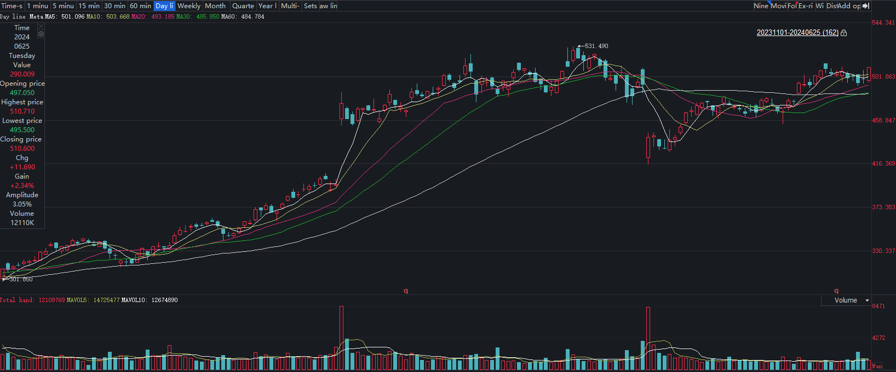
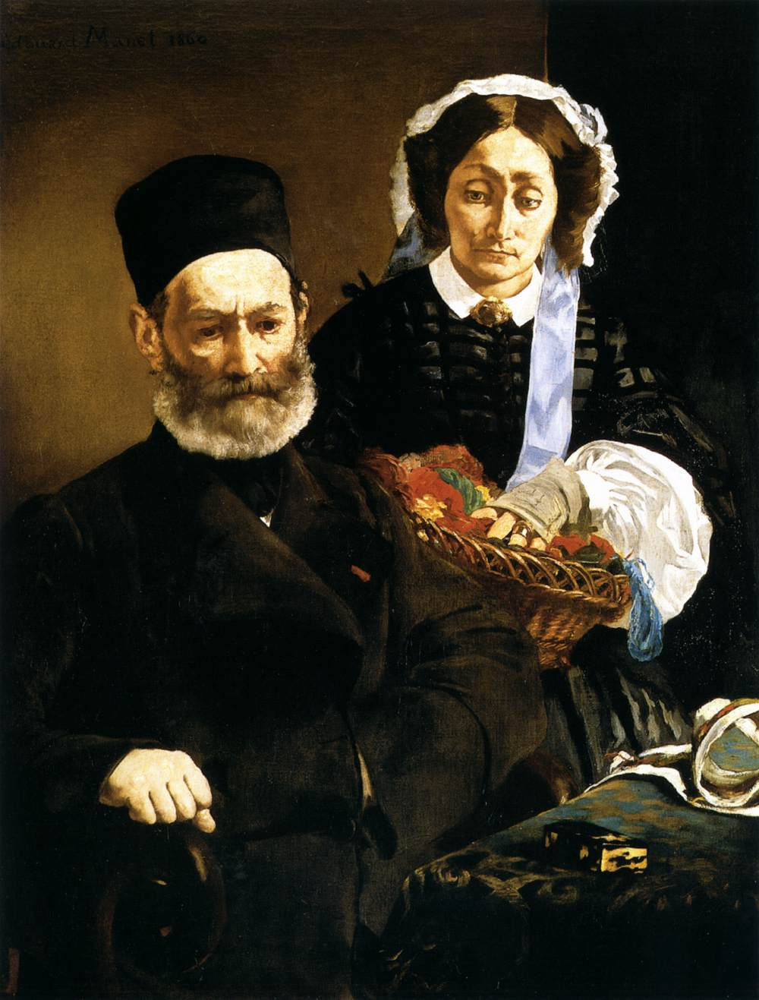

# 五领域图文问答原始样例

问题、参考和图像均来自源数据；用于展示，不代表当前1%训练选择。

<a id="textvqa"></a>
## T1 · TextVQA

源 ID：`TextVQA:0`。

what is the brand of phone?

```json
[
  "nokia",
  "nokia",
  "nokia",
  "nokia",
  "toshiba",
  "nokia",
  "nokia",
  "nokia",
  "nokia",
  "nokia"
]
```


<a id="slake"></a>
## T2 · SLAKE

源 ID：`SLAKE:0`。

What modality is used to take this image?

```json
[
  "MRI"
]
```


<a id="rsvqa-lr"></a>
## T3 · RSVQA-LR

源 ID：`RSVQA-LR:0`。

Is it a rural or an urban area

```json
[
  "urban"
]
```


<a id="mme-finance"></a>
## T4 · MME-Finance

源 ID：`MME-Finance:81`。

What does the image depict?

```json
[
  "The image displays a technical analysis chart for Meta Platforms, Inc., over a one-day (1D) period. Here are the key details depicted in the chart:\n1. **Candlestick Chart**:\n   - The chart employs candlesticks to represent price movements over time, with each candlestick depicting the opening, closing, high, and low prices for the given period. Red candlesticks indicate a price increase, while cyan candlesticks indicate a price decrease.\n2. **Price and Volume Indicators**:\n   - The current stock price is shown as 510.600, with a gain of +11.690 (or +2.34%) for the day.\n   - The volume of stocks traded is 12110K.\n3. **Moving Averages**:\n   - Several Simple Moving Averages (SMAs) are indicated in different colors:\n     - SMA 5 (white)\n     - SMA 10 (yellow)\n     - SMA 20 (pink)\n     - SMA 30 (green)\n     - SMA 60 (white)\n   - The exact values of these SMAs are provided as 501.096, 503.668, 493.185, 485.850, and 484.784, respectively.\n5. **Additional Features**:\n   - Volume bars at the bottom of the chart show the volume traded over corresponding periods, with red bars representing higher closing prices and cyan bars representing lower closing prices compared to the previous day's close."
]
```



<a id="aqua"></a>
## T5 · AQUA

源 ID：`AQUA:train:29568`。

what was exhibited at the 1861 salon

```json
[
  "this painting"
]
```


