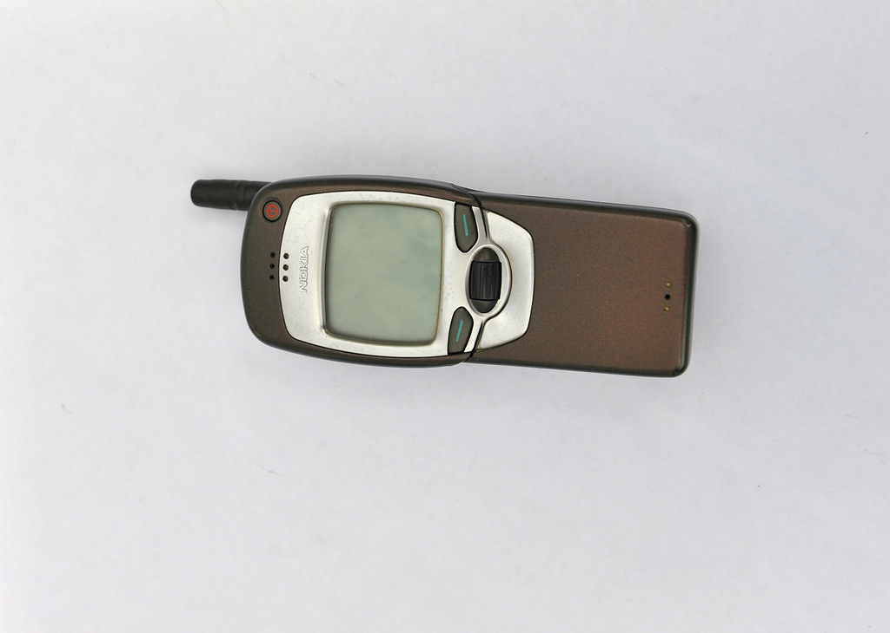
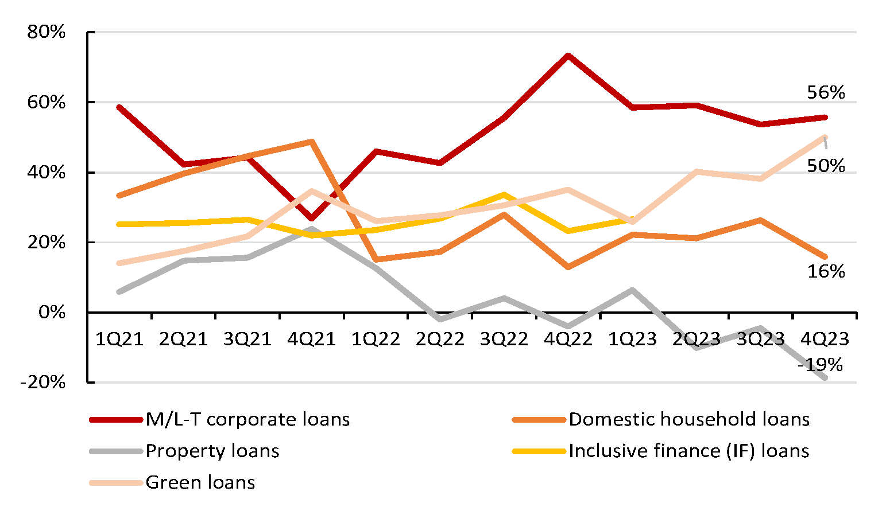
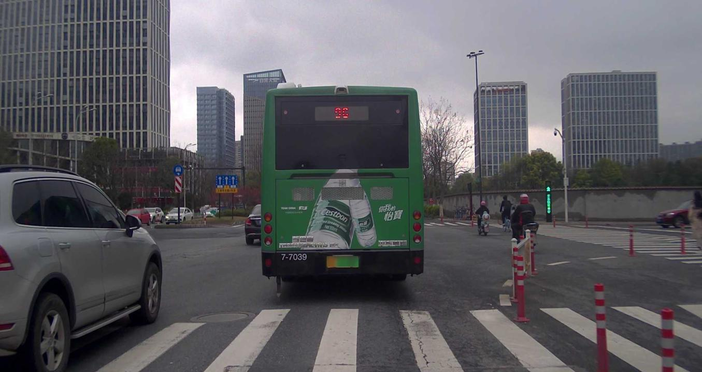

# 六领域原始图文问答示例

原问题、选项、答案保留；本页示例不是1%采样清单。

## T1 · TextVQA

源ID：`TextVQA:0`。

what is the brand of phone?

参考答案：

nokia

## T2 · SLAKE

源ID：`SLAKE:0`。

What modality is used to take this image?

参考答案：

MRI

## T3 · RSVQA-LR

源ID：`RSVQA-LR:0`。

Is it a rural or an urban area

参考答案：

urban

## T4 · FinMME

源ID：`FinMME:521`。

Which loan category had the highest growth rate in 1Q23?

原始选项／上下文：

A: M/L-T corporate loans
B: Domestic household loans
C: Inclusive finance (IF) loans
D: Property loans

参考答案：

A

## T5 · AQUA

源ID：`AQUA:train:29568`。

what was exhibited at the 1861 salon

参考答案：

this painting

## T6 · CODA-LM

源ID：`CODA-LM:Test:Test_general_0`。

<image>
There is an image of traffic captured from the perspective of the ego car. Focus on objects influencing the ego car's driving behavior: vehicles (cars, trucks, buses, etc.), vulnerable road users (pedestrians, cyclists, motorcyclists), traffic signs (no parking, warning, directional, etc.), traffic lights (red, green, yellow), traffic cones, barriers, miscellaneous(debris, dustbin, animals, etc.). You must not discuss any objects beyond the seven categories above. Please describe each object's appearance, position, direction, and explain why it affects the ego car's behavior.

参考答案：

In the traffic image under observation, several road users and elements are noticeable:

1. Vehicles:
   - A green bus is directly occupying the lane in front of our car, with its rear showing advertisements and displaying the bus number. This presence of the bus is significant as such large vehicles move slower, may block the view ahead, and often engage in passenger activities like stopping at bus stops, affecting the traffic flow.
   - A silver SUV is to the left and slightly ahead of our car in the adjacent lane. Monitoring the SUV is crucial as it might change lanes or continue moving forward, impacting the decisions for safe lane changes or turns by our vehicle.

2. Vulnerable Road Users:
   - To the right of the car, several cyclists are noted, moving parallel to our travel direction. Bicyclists, being vulnerable road users, might enter vehicle lanes or cross the street unexpectedly, requiring cautious driving and potential speed or positional adjustments.

3. Traffic Lights:
   - A green traffic light is visible in the distance on the right side above the cyclists. This light allows traffic in this lane to continue but suggests readiness to stop if the light changes.

4. Barriers:
   - On the right side of the road, a red and white striped barrier demarcates a pavement section. Such barriers are critical in signaling possible construction zones or lane closures that demand driving caution and may lead to deviations from normal driving patterns.

There are no traffic signs, traffic cones, or other miscellaneous objects in this observation, as indicated by the empty categories in the data.

