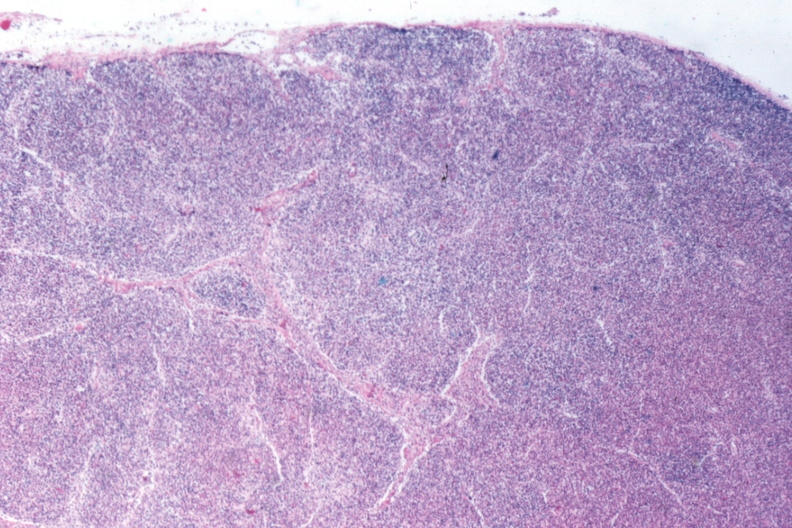
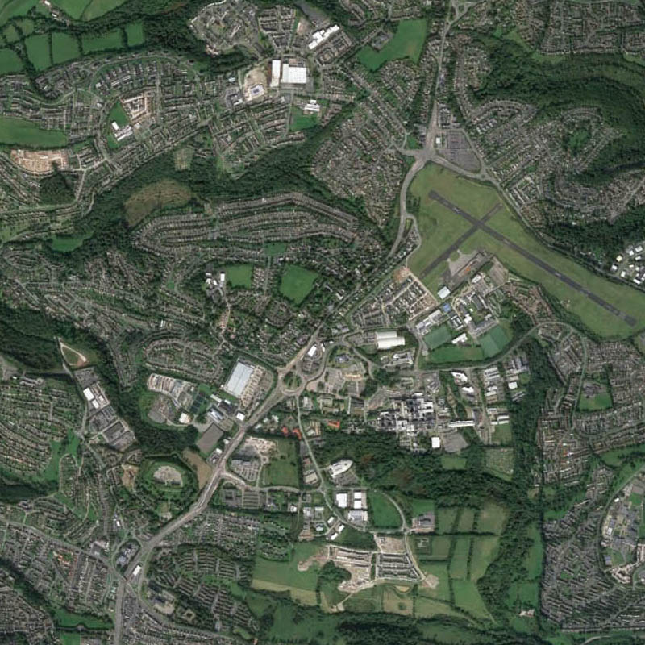
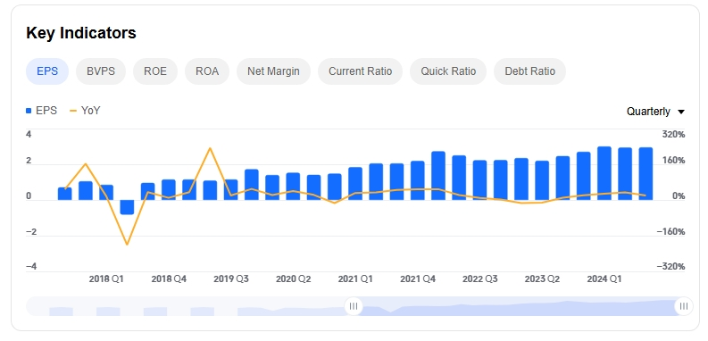

# 本轮十任务真实数据示例

每个任务展示固定训练清单中的第一条样本（index 0），按同一规则选取，不按答案内容或模型分数挑选。问题、上下文、答案和图像来自当前实际训练输入；示例不是模型预测。完整原始字段另存 [samples.json](samples.json)。原始数据文件保持不变。

## T01

领域：自然／通用；模态：text；数据集：SQuAD11；样本 ID：`SQuAD11:56dde39c66d3e219004dada0`。

**问题（原文）**

When was the Canada First Defence Strategy introduced?

**参考答案（原文）**

- 2008

原始上下文（完整）

Canadian defence policy today is based on the Canada First Defence Strategy, introduced in 2008. Based on that strategy, the Canadian military is oriented and being equipped to carry out six core missions within Canada, in North America and globally. Specifically, the Canadian Armed Forces are tasked with having the capacity to:

## T02

领域：自然／通用；模态：image；数据集：GQA；样本 ID：`GQA:train-16587699`。

**问题（原文）**

What animal is on the table?

**参考答案（原文）**

- kitten

## T03

领域：医学；模态：text；数据集：MedQuAD；样本 ID：`MedQuAD:MedQuAD-577bd37b96c02d1833b2c9eed2de9f96964e96cb/2_GARD_QA/0002711.xml-0`。

**问题（原文）**

What are the symptoms of Hairy nose tip ?

**参考答案（原文）**

- What are the signs and symptoms of Hairy nose tip? The Human Phenotype Ontology provides the following list of signs and symptoms for Hairy nose tip. If the information is available, the table below includes how often the symptom is seen in people with this condition. You can use the MedlinePlus Medical Dictionary to look up the definitions for these medical terms. Signs and Symptoms Approximate number of patients (when available) Abnormality of the hair - The Human Phenotype Ontology (HPO) has collected information on how often a sign or symptom occurs in a condition. Much of this information comes from Orphanet, a European rare disease database. The frequency of a sign or symptom is usually listed as a rough estimate of the percentage of patients who have that feature. The frequency may also be listed as a fraction. The first number of the fraction is how many people had the symptom, and the second number is the total number of people who were examined in one study. For example, a frequency of 25/25 means that in a study of 25 people all patients were found to have that symptom. Because these frequencies are based on a specific study, the fractions may be different if another group of patients are examined. Sometimes, no information on frequency is available. In these cases, the sign or symptom may be rare or common.

## T04

领域：医学；模态：image；数据集：PathVQA；样本 ID：`PathVQA:train-00001-of-00007-47d8e0220bf6c933-1469`。

**问题（原文）**

what appears to have changed into a blast crisis?

**参考答案（原文）**

- total effacement case

## T05

领域：地理／遥感；模态：text；数据集：GeoQuestions1089；样本 ID：`GeoQuestions1089:97`。

**问题（原文）**

What is the population of the Greek region of Epirus?

**参考答案（原文）**

- 350679

## T06

领域：地理／遥感；模态：image；数据集：GeoChat_Instruct；样本 ID：`GeoChat_Instruct:134484:0`。

**问题（原文）**

How many airports are present in the image?

**参考答案（原文）**

- There is only one airport present in the image.

## T07

领域：金融；模态：text；数据集：FinQA；样本 ID：`FinQA:CNC/2003/page_41.pdf-1`。

**问题（原文）**

what was the percentage change in pro forma revenue from 2001 to 2002?

**参考答案（原文）**

- 44%

原始上下文（完整）

disclosure of , the issuance of certain types of guarantees .
the adoption of fasb interpretation no .
45 did not have a signif- icant impact on the net income or equity of the company .
in january 2003 , fasb interpretation no .
46 , 201cconsolidation of variable interest entities , an interpretation of arb 51 , 201d was issued .
the primary objectives of this interpretation , as amended , are to provide guidance on the identification and consolidation of variable interest entities , or vies , which are entities for which control is achieved through means other than through voting rights .
the company has completed an analysis of this interpretation and has determined that it does not have any vies .
4 .
acquisitions family health plan , inc .
effective january 1 , 2004 , the company commenced opera- tions in ohio through the acquisition from family health plan , inc .
of certain medicaid-related assets for a purchase price of approximately $ 6800 .
the cost to acquire the medicaid-related assets will be allocated to the assets acquired and liabilities assumed according to estimated fair values .
hmo blue texas effective august 1 , 2003 , the company acquired certain medicaid-related contract rights of hmo blue texas in the san antonio , texas market for $ 1045 .
the purchase price was allocated to acquired contracts , which are being amor- tized on a straight-line basis over a period of five years , the expected period of benefit .
group practice affiliates during 2003 , the company acquired a 100% ( 100 % ) ownership interest in group practice affiliates , llc , a behavioral healthcare services company ( 63.7% ( 63.7 % ) in march 2003 and 36.3% ( 36.3 % ) in august 2003 ) .
the consolidated financial state- ments include the results of operations of gpa since march 1 , 2003 .
the company paid $ 1800 for its purchase of gpa .
the cost to acquire the ownership interest has been allocated to the assets acquired and liabilities assumed according to estimated fair values and is subject to adjustment when additional information concerning asset and liability valuations are finalized .
the preliminary allocation has resulted in goodwill of approximately $ 3895 .
the goodwill is not amortized and is not deductible for tax purposes .
pro forma disclosures related to the acquisition have been excluded as immaterial .
scriptassist in march 2003 , the company purchased contract and name rights of scriptassist , llc ( scriptassist ) , a medication com- pliance company .
the purchase price of $ 563 was allocated to acquired contracts , which are being amortized on a straight-line basis over a period of five years , the expected period of benefit .
the investor group who held membership interests in scriptassist included one of the company 2019s executive officers .
university health plans , inc .
on december 1 , 2002 , the company purchased 80% ( 80 % ) of the outstanding capital stock of university health plans , inc .
( uhp ) in new jersey .
in october 2003 , the company exercised its option to purchase the remaining 20% ( 20 % ) of the outstanding capital stock .
centene paid a total purchase price of $ 13258 .
the results of operations for uhp are included in the consolidated financial statements since december 1 , 2002 .
the acquisition of uhp resulted in identified intangible assets of $ 3800 , representing purchased contract rights and provider network .
the intangibles are being amortized over a ten-year period .
goodwill of $ 7940 is not amortized and is not deductible for tax purposes .
changes during 2003 to the preliminary purchase price allocation primarily consisted of the purchase of the remaining 20% ( 20 % ) of the outstanding stock and the recognition of intangible assets and related deferred tax liabilities .
the following unaudited pro forma information presents the results of operations of centene and subsidiaries as if the uhp acquisition described above had occurred as of january 1 , 2001 .
these pro forma results may not necessar- ily reflect the actual results of operations that would have been achieved , nor are they necessarily indicative of future results of operations. .
Table:
 | 2002 | 2001
Revenue | $567,048 | $395,155
Net earnings | 25,869 | 11,573
Diluted earnings per common share | 1.48 | 1.00
diluted earnings per common share 1.48 1.00 texas universities health plan in june 2002 , the company purchased schip contracts in three texas service areas .
the cash purchase price of $ 595 was recorded as purchased contract rights , which are being amortized on a straight-line basis over five years , the expected period of benefit .
bankers reserve in march 2002 , the company acquired bankers reserve life insurance company of wisconsin for a cash purchase price of $ 3527 .
the company allocated the purchase price to net tangible and identifiable intangible assets based on their fair value .
centene allocated $ 479 to identifiable intangible assets , representing the value assigned to acquired licenses , which are being amortized on a straight-line basis over a notes to consolidated financial statements ( continued ) centene corporation and subsidiaries .

## T08

领域：金融；模态：image；数据集：MME_Finance；样本 ID：`MME_Finance:954`。

**问题（原文）**

What does this image show?

**参考答案（原文）**

- The image displays a financial chart focusing on the key indicators of a company over a period from the first quarter of 2018 (2018 Q1) to the first quarter of 2024 (2024 Q1). Specifically, it presents two metrics: Earnings Per Share (EPS) and Year-over-Year (YoY) growth.
### Insights:
- **Earnings Per Share (EPS)**: Represented by blue bars, EPS indicates the company&#x27;s profitability on a per-share basis. The observation shows an increasing trend from early 2018 to early 2024, interrupted occasionally by dips.
- **Year-over-Year (YoY) Growth**: Represented by the yellow line, this metric shows the annual growth rate. There are significant fluctuations in the YoY growth over the time period. Early in the observed period, YoY growth exhibits sharp volatility, including periods of negative growth, indicating significant annual fluctuations in performance.

## T09

领域：艺术文化；模态：text；数据集：AQUA；样本 ID：`AQUA:train-58355`。

**问题（原文）**

what are part of a polyptych executed for the church of the convent of san francesco at borgo san sepolcro

**参考答案（原文）**

- these panels

## T10

领域：艺术文化；模态：image；数据集：AQUA；样本 ID：`AQUA:train-28238`。

**问题（原文）**

what is the location of the picture

**参考答案（原文）**

- street

