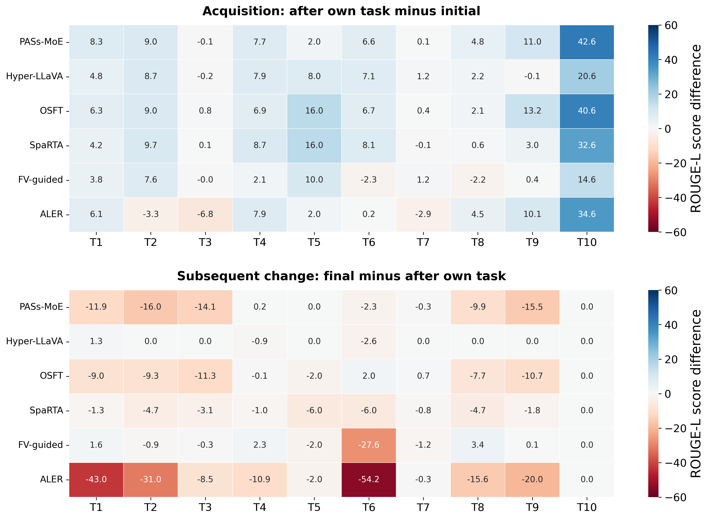

# 为什么专业任务分数低：识别、知识、推理、输入与遗忘的诊断

快照：2026-10-15T18:48:43.030456+08:00。核查 6 个已完成方法的 33,000 条原始预测，另运行冻结基座的 250 条独立诊断生成。

**结论：目前只能部分支持“专业知识不足”，不能支持“图像已有效识别，唯一瓶颈是专业知识”。** 这轮同时发现了细粒度识别／视觉语义映射错误、专业事实错配、金融计算失败、输入证据缺失、输出格式与词面评分偏差，以及方法相关的后续遗忘。现有证据不能把全部误差归到单一原因。

主实验数据、训练、生成设置和分数均未修改；诊断使用单独输出目录，绝不混入主表。以下“正确”只在明确说明时指原标注的精确匹配，不等于专家复核的语义正确。

## 1. 先纠正旧结论的边界

旧[医学诊断报告](../../../analysis/research_grounding_20261008/README.md)记录的是：旧医学子集的粗粒度部位识别 98.85%，医学是非问答 59.29%，严格同问法图像对两边均正确率为 0。报告明确写明：部位识别好不代表病灶特征已编码或能被语言侧读取。提供正确征象的文字事实后能回答，也更指向“图像证据→可用事实”的转换问题，不能据此证明只有医学知识缺失。

旧实验是不同病例、不同问法与评价方式；不能把其 98.85% 直接当作本轮 50 条医学开放 QA 的视觉识别率。

## 2. 训练前就不会，还是学完后忘了？

下面选三个有代表性的专业任务与现象作对照；完整六方法十任务分解见 [CSV](task_diagnostics.csv)。分数均为 ROUGE-L。

| 方法 | 任务 | 训练前 | 刚学完该任务 | 全序列训练结束 | 解释边界 |
|---|---|---:|---:|---:|---|
| Hyper-LLaVA | T3 | 15.72 | 15.53 | 15.53 | 训练前已低，训练后改善有限，后续几乎未再下降 |
| Hyper-LLaVA | T4 | 5.30 | 13.22 | 12.35 | 已有能力不足，也有少量后续下降 |
| Hyper-LLaVA | T7 | 5.93 | 7.13 | 7.13 | 有上下文但仍低分，需查数值推理及评分 |
| Hyper-LLaVA | T6 | 55.12 | 62.23 | 59.59 | 遥感不是普遍不会，已能获得较高词面分数 |
| FV-guided | T6 | 55.12 | 52.79 | 25.20 | 后续明显下降，不能仅解释为初始缺少专业知识 |
| ALER | T6 | 55.16 | 55.32 | 1.13 | 训练后大幅丢失，存在严重后续性能退化 |

上图第一部分衡量从初始到刚学完的变化，第二部分衡量此后变化。第二部分的 T10 必为 0，因为它没有后续阶段。色值是分数点差，不能直接解释为知识量；生成风格变化也可能改变 ROUGE-L。

## 3. 医学：配对控制显示格式有影响，视觉有贡献，但识别并未全部解决

在空闲 GPU3 上加载原始 Qwen2-VL-2B-Instruct，冻结所有参数，seed 42，greedy 解码；对原固定 T4 测试 50 题逐题做三个条件。原问题、原图及参考答案保持不变；短答案条件只改诊断提示，无图条件只移除图像。三条件上限均为 64 tokens。

| 独立诊断条件 | EM 正确／总数 | EM % | Token F1 | ROUGE-L |
|---|---:|---:|---:|---:|
| 原图＋原提示 | 0/50 | 0.0 | 5.30 | 5.30 |
| 原图＋仅要求短答案 | 5/50 | 10.0 | 11.79 | 11.79 |
| 无图＋同样要求短答案 | 1/50 | 2.0 | 3.12 | 3.12 |

只改输出要求使 EM 从 0/50 到 5/50，因此低 EM 部分反映格式，而不是完全没有答案。短答案条件下有图 5/50、无图 1/50，说明图像有净收益；但样本仅 50，不能将 8 个百分点外推为通用视觉能力水平。

根据原题中器官／部位／颜色／扫描平面／加权方式关键词作探索性分组，视觉基础题 10 条、其余医学题 40 条。短答案＋原图分别完全匹配 3/10、2/40；无图分别为 0/10、1/40。这里“其余”不等于全部都是知识题，且来源比例不同，不能把组间差异当作知识的因果效应。

重复原提示的控制与正式初始预测逐字相同：医学 48/50，金融 50/50；医学三项总体分数一致。个别推理文本并非逐字重现，因此以本次同进程配对结果作诊断比较。

### 可核查的支持与反例

| 原题 ID | 参考与实际输出 | 能说明什么 |
|---|---|---|
| SLAKE:test-13312 | 参考“腹部”；原提示答“图像中包含的区域属于身体的腹部。”，EM=0；短提示答“腹部”，EM=100；无图答“头” | 有效视觉信息确实存在，原分数有格式损失 |
| SLAKE:test-11957 | 问主器官，参考 Lung；初始答 heart，Hyper-LLaVA 最终仍答 Heart | 与原标注相比，连器官识别也有失败，反对“都已识别正确” |
| SLAKE:test-11984 | 问疾病，短提示＋图像答 Pneumonia，与原标注一致；无图答 None | 不能说模型完全没有任何专业识别／知识能力 |
| PathVQA:…-1851 | 参考 cytomegalovirus，初始只答 microscopic view of a tissue sample | 粗略识别图像类型不等于识别细粒度目标；视觉编码、跨模态读取和知识仍未分离 |

T4 原有 PathVQA 题还包含部分表述不流畅的原始问答，详见逐题记录；这是源数据与问法的额外变量，本报告不擅自改写或删除。

## 4. 专业知识不足：有直接实例，但不是全部任务的共同唯一解释

MedQuAD 测试首题询问 metachromatic leukodystrophy 的遗传改变：原标注涉及 ARSA／PSAP，初始模型却生成 alpha-synuclein，Hyper-LLaVA 最终生成 alpha-glucosidase。另一个 SPENCDI 题的原标注为 ACP5，模型初始和最终均给出 CACNA1A。这里按数据集参考记录事实错配，不作独立临床结论。

这些纯文本题没有图像输入，因此错误不能归为“没看懂图”。它们支持专业事实缺失、提取失败或混淆的解释；但仅看输出不能区分知识从未储存、未被成功提取，或生成时被其他知识干扰。没有正确外部知识条件的配对干预，尚不能认定“补知识就能修好”。

## 5. 金融：还有数字选择、算术与输出协议问题

对固定 T7 的全部 50 条题，另做原输入与“额外给出原标注 program_reference”的配对。该 oracle 泄露了正确运算结构和操作数，是诊断正对照，绝不是可用于主表的公平方法，也不使用最终答案作提示。

| 条件 | EM % | Token F1 | ROUGE-L | 达到 128-token 上限 |
|---|---:|---:|---:|---:|
| 原始 FinQA 输入 | 0.0 | 5.93 | 5.93 | 0/50 |
| 额外提供原标注运算程序（oracle） | 0.0 | 7.16 | 7.10 | 5/50 |

整段 EM 两者都为 0 不能据此判定 oracle 完全无效：模型经常附带 Computations／Answer，和纯数值参考不完全一致。为此另作有符号数字抽取、百分比单位和参考精度舍入的探索性核查：原输入 0/50、oracle 7/50 落入数值等价候选范围。它采用较宽松的百分数表示规则，是乐观的诊断标记，**不是 FinQA 官方执行准确率，也不替换原分数**。规则和逐题结果见 [数值审计](numeric_format_audit.json)。

例：原输入已选出 `254000 / 107000`，却输出 `2.3617`，与参考 `2.37` 不符；oracle 变成 `2.37143`，按参考两位小数精度可接受。另题给出正确 `subtract(28.9,27.8), divide(#0,27.8)` 后，仍输出 `0.07419`，而标注约为 3.95%。部分问题即使提供操作结构仍算错，说明数字执行／指令遵循也是限制。

该对照同时提供结构和数值，不能把 7 题改善单独归因于专业术语知识；oracle 还引入额外提示长度，5 题触及生成上限，也限制其解释。

## 6. 输入与评分会放大专业域差距

| 项目 | 实测事实 | 对解释的影响 |
|---|---|---|
| T1 vs T3 | SQuAD 50/50 有参考段落；MedQuAD 0/50 有上下文 | 比较的是有依据阅读与闭卷专业生成，不是只改变领域 |
| T5 地理 | 50/50 既无图也无上下文，未连接地理知识库 | 精确空间计数不能当作普通地理常识；输入缺数据库证据是关键变量 |
| T9 艺术知识 | 50/50 无图／上下文；存在仅问 what is the painting 的题 | 部分题缺少指代对象，低分不等于单纯缺艺术知识；并非所有艺术题都如此 |
| T3 输出长度 | 最短参考平均 248.06 tokens，6/50 超过 512-token 上限 | 长参考与受限生成下，EM／覆盖度分数不能独立代表事实正确率 |
| T8 输出长度 | 最短参考平均 159.04 tokens，23/50 超过 128-token 上限 | 不能要求所有模型完整复述长参考；仍须区分内容正确和覆盖不足 |
| 数字／中文评分 | five 与 5 得不到词面匹配；白色与黑色共享“色”，可得 F1/ROUGE-L 50 | 词面分数既可能低估正确答案，也可能给错误答案较高分 |

MME_Finance:883 初始答 The image displays five quarters，参考 5，三项分数均为 0；最终只答 5，三项均为 100。相反 SLAKE:test-13382 的参考“黑色”，初始“图中左肺显示黑色。”得 ROUGE-L 40，最终“白色”却得 50。因此一部分“提高／遗忘”可能来自表达和词面打分变化，不能直接当作语义能力变化。

GeoQuestions1089 原任务提供 SPARQL／GeoSPARQL 查询及其知识图谱答案，参见[作者仓库](https://github.com/AI-team-UoA/GeoQuestions1089)。AQUA 是视觉与艺术背景知识问答，参见[原论文](https://arxiv.org/abs/2008.12520)；[ArtQuest（WACV 2024）](https://openaccess.thecvf.com/content/WACV2024/papers/Bleidt_ArtQuest_Countering_Hidden_Language_Biases_in_ArtVQA_WACV_2024_paper.pdf)也指出其语言偏差，故不把所有艺术错误都当作视觉识别失败。

## 7. 当前可写进文章的结论与不能写的结论

**可支持的表述：** 在当前小样本持续学习设置中，专业领域的性能瓶颈具有多因素性。模型可利用部分视觉线索，但细粒度视觉语义映射和专业事实生成仍存在错误；有些专业任务在训练前就处于低性能状态，有些方法又出现显著后续退化。输出格式、长参考与输入证据不足进一步影响统一词面指标的解释。

**尚不支持：** “视觉识别已经解决”“所有专业域都只差领域知识”“补知识必然恢复”“低 ForgetRate 代表学得好”。刚学完与最终都低也可以得到低遗忘。这里没有给出各原因的互斥占比，案例也不代表发生率。

若要进一步确定主因，下一轮需要将“图像分辨率／视觉证据”“独立来源的专业知识”“数值执行器”分别作为独立干预，且明确禁止把目标答案混入正常评测。图像消融存在分布变化，正确参考事实注入只能作 oracle；不能把二者单独当作因果终证。当前没有保存训练后模型 checkpoint，不能在已完成六种方法的历史权重上补做这些探针；本报告的干预仅针对冻结初始基座，不冒充训练后机制结论。

## 文件与复现

- [输入条件与参考长度](input_conditions.csv)、[任务分解](task_diagnostics.csv)、[来源分解](source_diagnostics.csv)、[医学题型分组](medical_question_groups.csv)、[金融图表题型](finance_chart_categories.csv)。
- [全部阶段分数与生成上限命中数](all_stage_diagnostics.csv)、[图的原始数据](figure_data.json)、[矢量 PDF](acquisition_vs_retention.pdf)。
- [诊断配置](probe_config.json)、[诊断逐题预测](probe_predictions.jsonl)、[诊断汇总](probe_summary.json)、[配对核验](paired_probe_checks.json)。
- 原问题、参考与三时点预测的完整连接记录为本服务器同目录 `joined_predictions.jsonl`；只读导出，不作为新训练集。
- 脚本位于 `exp/ten_task_cl_20261014_geo_fin/`：`audit_failure_causes.py`、`probe_failure_causes.py`、`numeric_probe_audit.py`、`report_failure_causes.py`。
- Manifest SHA-256：`dab25e3940758cfac3e1bb16da5305ce6393dfa4eb22e1c39d4f99a28fdc4208`。一个训练 seed，未做跨 seed 显著性推断。
