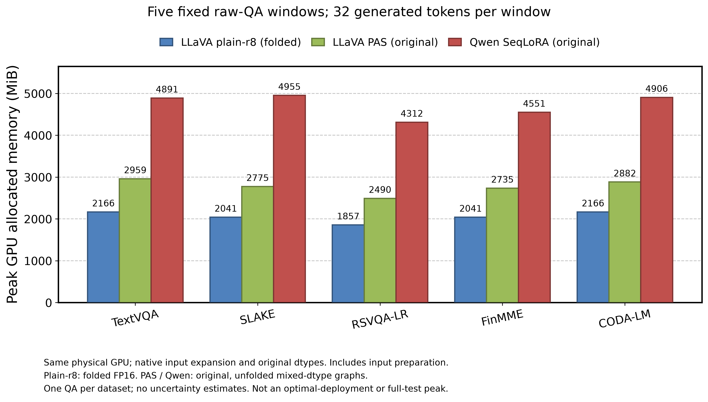

# 固定五窗GPU内存：已核验资源参照

图中每个数据集只有一条固定原始QA；三种完整模型均在OLD物理GPU1上，每题生成32个新token，统计包含输入准备的 `torch.cuda.max_memory_allocated`。MiB=1048576字节。不是域内均值、全测试集峰值或重复实验分布，不设置虚构误差条。

| 原实现／保存表示 | TextVQA | SLAKE | RSVQA-LR | FinMME | CODA-LM |
| --- | ---: | ---: | ---: | ---: | ---: |
| LLaVA plain-r8，fold后FP16 | 2166.101 | 2041.106 | 1856.979 | 2041.101 | 2166.092 |
| LLaVA PAS，原混合dtype／未fold | 2959.415 | 2774.938 | 2490.443 | 2735.135 | 2882.102 |
| Qwen SeqLoRA，原混合dtype／未fold | 4890.847 | 4954.604 | 4311.996 | 4550.724 | 4905.765 |

LLaVA plain-r8相对PAS逐窗低24.84%–26.81%，相对Qwen低55.15%–58.80%。这证明这三个原实现的资源差异，包含专家表示、骨干及dtype因素。各骨干保留原生输入展开，同原始图片／上下文不等于相同视觉token或prepared tensor；原始ID、输入摘要、token数和精确数值见[绘图数据](plot_data.json)。同LLaVA两图的prepared输入摘要也逐条相同。

朴素r8来自探索FIT；PAS和Qwen来自各自原正式最终checkpoint。本图只比较资源，不将探索DEV与正式TEST的F1放在一起排名，不将朴素r8的峰值直接移植给ARC，也不将骨干差异称为新增门的结构贡献。未测试同dtype最优部署、量化、速度或完整分布最坏峰。

数据入口：[朴素r8核验](../../plain_r8_gpu_control_20261025/v1/VERIFIED.json)、[PAS核验](../../strong_pas_resource_20261025/v1/VERIFIED.json)及其独立memory.json、[Qwen核验](../../strong_qwen_resource_20261025/v1/VERIFIED.json)。制图脚本硬绑定三份原核验SHA、附属memory和COMPLETE摘要，再核同卡、同boot、同五个raw输入、32新token和单位；不读取模型或重新评分。

复现：仓库根目录运行 `python analysis/edge_resource_figure_20261025.py`，需Matplotlib与NumPy。本次使用独立本地绘图依赖目录，CPU仅处理已有标量与制图，0模型／生成／评分。样式逐字节复制项目已有 `analysis/omnimed_20261009/plot_templates/style.py`，布局沿用其grouped_bar模板；输出300DPI PNG与矢量[PDF](fixed_window_memory.pdf)，并人工查看PNG检查布局。
