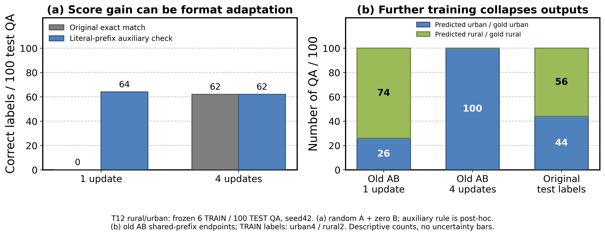

# 初始习得、后续覆盖与多数答案坍缩审计

CPU只读；全部被读取预测及完成证明SHA核验，确定性完整T1逐元素复现门槛通过。原评分、训练数据、图像、权重保持不变。

## 确定性19原生任务：生成诊断155题

| 状态 | 原始答对／总数 | 仅去固定英文前缀的辅助正确数 | 含该前缀的输出数 |
| --- | ---: | ---: | ---: |
| base | 1/155 | 31/155 | 104 |
| pre | 31/155 | 34/155 | 8 |
| isolated | 26/155 | 43/155 | 65 |
| acquired | 47/155 | 47/155 | 0 |
| final | 47/155 | 47/155 | 0 |

pre和acquired是每个任务各自的时点汇总，**不是一个统一模型快照**；isolated为19个独立模型，final为单一最终模型。所有当前任务共享冻结QA／训练步数，但历史训练量不同。不能据此把正迁移完全归于多领域而排除额外训练。

固定规则仅删除一次开头The answer is，然后调用原评分器。基座同155题原EM为1，辅助为31；最终模型原／辅助均47。原始差46题，格式敏感性检查下差16题，提示不能把所有原EM增量直接解释为知识或视觉能力学习；这不是对训练增益的严格因果百分比拆分。规则在此为事后辅助，不替代主结果，不构成通用语义正确性判断。

acquired→final逐题转移：保留38，丢失9，新增9，始终错误99。这是稀疏生成诊断的汇总，不是完整FWT/BWT。

| 原生任务 | TRAIN | base | pre | isolated | acquired | final | 习得后丢失／新增 |
| --- | ---: | ---: | ---: | ---: | ---: | ---: | --- |
| T01 natural | 347 | 0/10 | 0/10 | 5/10 | 5/10 | 4/10 | 1/0 |
| T02 medical | 11 | 0/10 | 2/10 | 0/10 | 3/10 | 8/10 | 0/5 |
| T03 medical | 17 | 0/10 | 0/10 | 0/10 | 2/10 | 1/10 | 1/0 |
| T04 medical | 26 | 0/10 | 4/10 | 2/10 | 3/10 | 4/10 | 1/2 |
| T05 medical | 6 | 0/6 | 4/6 | 0/6 | 4/6 | 3/6 | 1/0 |
| T06 medical | 14 | 0/10 | 2/10 | 0/10 | 3/10 | 4/10 | 0/1 |
| T07 medical | 4 | 0/5 | 1/5 | 0/5 | 2/5 | 2/5 | 0/0 |
| T08 medical | 5 | 0/6 | 0/6 | 0/6 | 0/6 | 0/6 | 0/0 |
| T09 medical | 1 | 0/2 | 0/2 | 0/2 | 0/2 | 0/2 | 0/0 |
| T10 medical | 3 | 0/4 | 2/4 | 0/4 | 2/4 | 2/4 | 0/0 |
| T11 medical | 12 | 0/10 | 1/10 | 0/10 | 1/10 | 1/10 | 0/0 |
| T12 geography | 6 | 0/2 | 2/2 | 0/2 | 2/2 | 2/2 | 0/0 |
| T13 geography | 170 | 1/10 | 7/10 | 10/10 | 9/10 | 5/10 | 5/1 |
| T14 geography | 171 | 0/10 | 0/10 | 2/10 | 3/10 | 3/10 | 0/0 |
| T15 geography | 226 | 0/10 | 6/10 | 6/10 | 5/10 | 5/10 | 0/0 |
| T16 finance | 89 | 0/10 | 0/10 | 1/10 | 3/10 | 3/10 | 0/0 |
| T17 traffic | 49 | 0/10 | 0/10 | 0/10 | 0/10 | 0/10 | 0/0 |
| T18 traffic | 107 | 0/10 | 0/10 | 0/10 | 0/10 | 0/10 | 0/0 |
| T19 traffic | 49 | 0/10 | 0/10 | 0/10 | 0/10 | 0/10 | 0/0 |

## 遥感rural：训练loss下降，但输出坍缩为多数答案

冻结TRAIN仅6题（urban4/rural2），原TEST100题（urban44/rural56）；所有问题相同，图片不同。完整旧AB起点由1更新76/100降为4更新44/100，后者100题全部输出urban；等于只猜TRAIN多数类别的测试成绩。当前结果直接证明输出坍缩，**尚不能证明训练标签比例就是唯一原因**，也不意味着模型没有读取图像。

| 起点 | 更新 | 原EM | 固定前缀辅助正确数 | 未解析 | 测试NLL |
| --- | ---: | ---: | ---: | ---: | ---: |
| random_A_zero_B | 1 | 0/100 | 64/100 | 0 | 5.2129 |
| random_A_zero_B | 4 | 62/100 | 62/100 | 0 | 0.3359 |
| past_A_zero_B | 1 | 0/100 | 66/100 | 0 | 4.5505 |
| past_A_zero_B | 4 | 69/100 | 69/100 | 0 | 0.3008 |
| past_AB | 1 | 76/100 | 76/100 | 0 | 0.2958 |
| past_AB | 4 | 44/100 | 44/100 | 0 | 0.3737 |

辅助规则仅去除固定英文前缀The answer is及末尾标点，使用TRAIN的rural/urban标签字典，不按测试答案搜索匹配；属于事后诊断，不能替换主EM。单更新随机A／旧A零B的0分不能直接等同于完全不会判断图像。

旧AB训练记录loss为0.5561→0.3295→0.2616→0.2354，每个数均在对应更新前记录；它们不是终点1／4同权重的训练集评测，不能据此直接估计终点泛化差。下一步应在原冻结权重上补测6条TRAIN及原图／错图／无图，观察固定标签的输出概率和生成变化，不改训练池、不新增方法。

## 可以排除与仍待验证

- “LoRA从未更新”不成立：先前因子审计已确认正LR和实际deltaW；本次观察到生成行为明确改变。不能据此证明参数更新都有效。
- “所有0分都代表缺少知识”不成立：至少rural存在字面答案前缀导致原EM归零的情况；该任务不代表所有医学／金融题。
- “多训练必定更好”不成立：同一旧AB轨迹出现生成坍缩与测试NLL上升。多数答案偏置、图像区分退化、概率阈值变化仍需分开。
- “后续任务只带来遗忘”不能预设：原生对照同时存在保留、丢失与新增，需按任务报告，不能用总分遮蔽转移。

完整计数／原始输出频率／混淆表／训练loss及梯度／文件SHA见[机器可读审计](ACQUISITION_COLLAPSE_AUDIT.json)。

图A为随机A零B的1／4更新，图B为旧AB的1／4更新，不能当同一轨迹比较。绘图沿用项目grouped-bar模板，PNG300dpi及PDF、原绘图数据和脚本保留。
