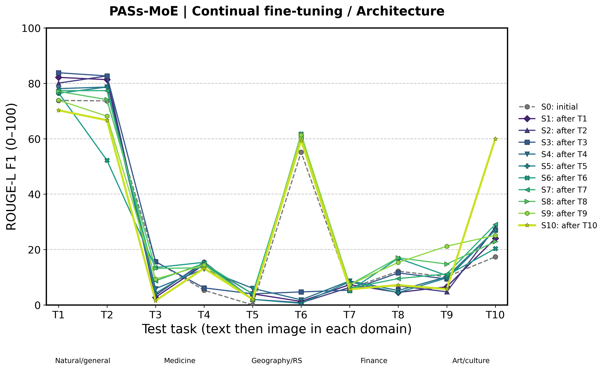
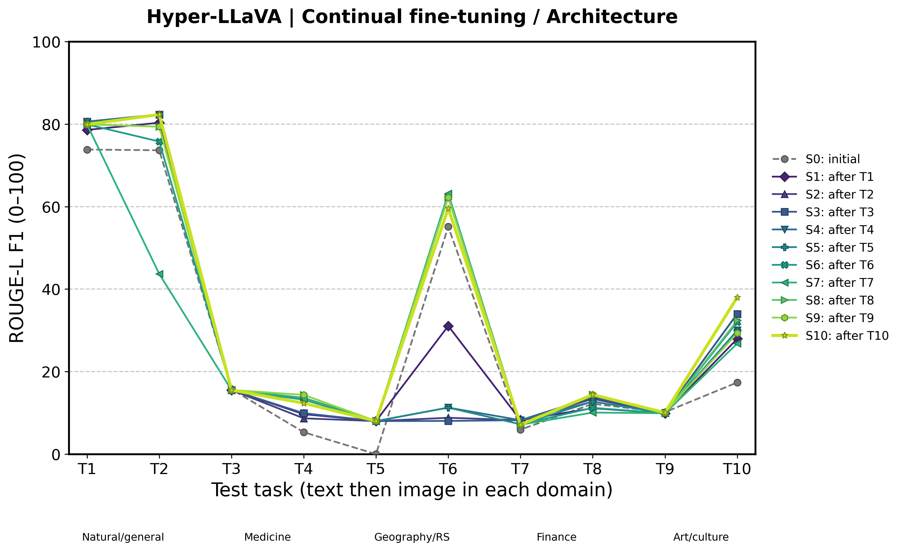
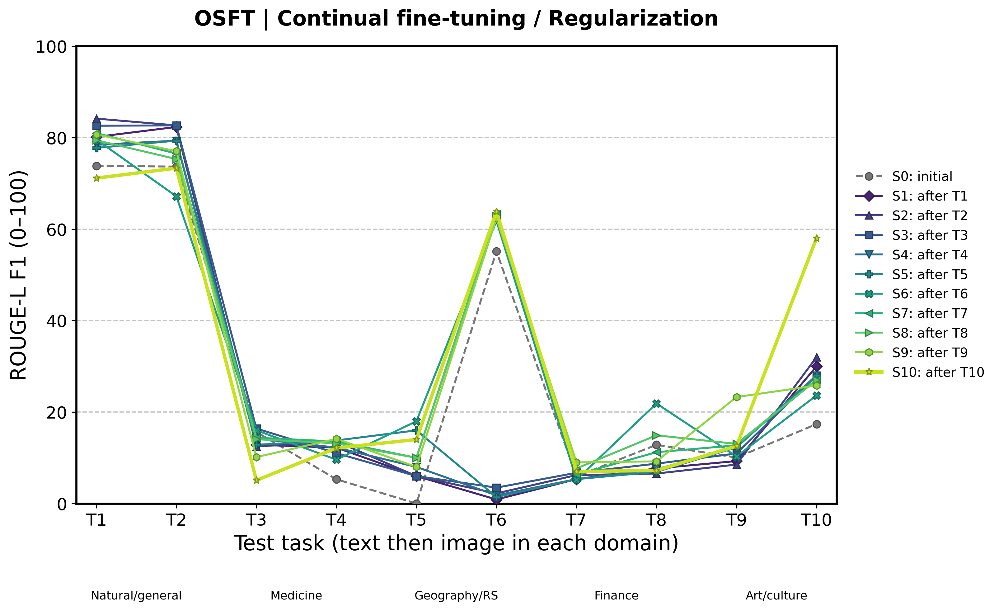
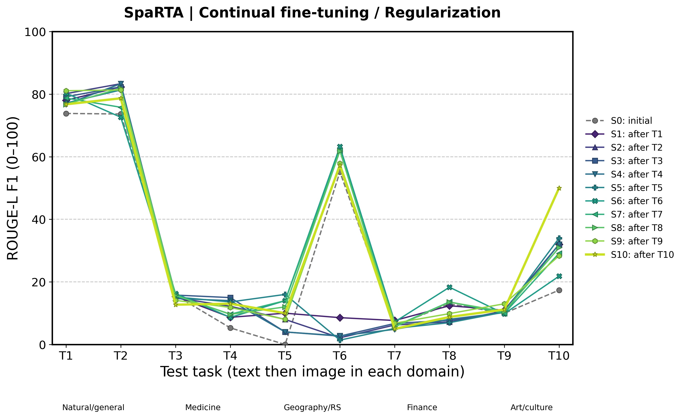
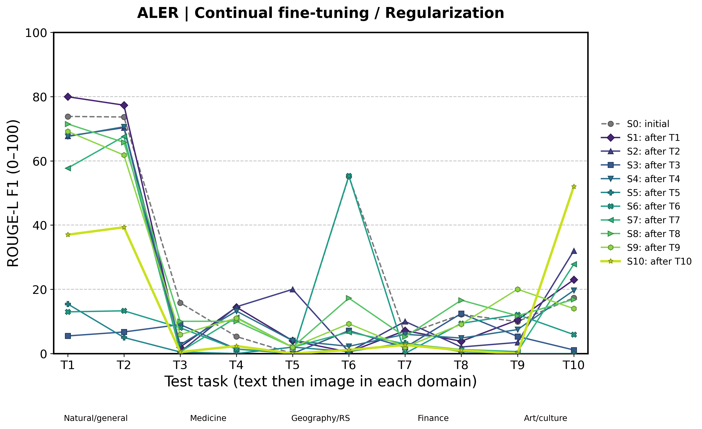

# 已完成结果：逐阶段十任务性能与最终指标

生成时间：2026-10-15T13:34:47.621562+08:00。本报告是独立快照，实时队列不会覆盖。

已完成 **5/8** 个方法，每个方法核验 **110 个评测单元、5500 条逐题预测**，ID 与冻结测试集一致；逐题分数均值与矩阵、最终指标交叉核对通过。

基座 Qwen2-VL-2B-Instruct；每任务训练 100／测试 50，无验证集；一轮训练；仅 seed 42；不保存 checkpoint。所有方法使用相同冻结样本及训练顺序。

## 图怎么读

每个完成的方法一张图，**11 条折线，每条 10 个节点**。横轴 T1–T10 是测试任务；S0 是训练前，S1–S10 分别是完成相应训练阶段后的十任务评测。颜色和标记在所有方法间一致；纵轴统一为 0–100 的 ROUGE-L F1，越高越好。

同一条线连接的是不同测试任务；观察同一任务在 11 条线上的纵向变化，才是该任务随训练的性能变化。没有插值、平滑或缺失值补齐。

| 任务 | 领域 | 模态 | 数据集 |
|---|---|---|---|
| T1 | 自然／通用 | 文本 | SQuAD 1.1 |
| T2 | 自然／通用 | 图像 | VQAv2 / GQA / TextVQA |
| T3 | 医学 | 文本 | MedQuAD |
| T4 | 医学 | 图像 | VQA-RAD / PathVQA / SLAKE |
| T5 | 地理／遥感 | 文本 | GeoQuestions1089 |
| T6 | 地理／遥感 | 图像 | GeoChat |
| T7 | 金融 | 文本 | FinQA |
| T8 | 金融 | 图像 | MME-Finance PC |
| T9 | 艺术／文化 | 文本 | AQUA knowledge |
| T10 | 艺术／文化 | 图像 | AQUA visual |

## 论文二维表中的定义

本轮方法均属于二维表的**持续微调**大类。基于架构的方法主要通过专家、模块或路由结构分离和组合任务能力；基于正则化的方法通过子空间、梯度或表征／输出约束保护已有知识。这里沿用仓库论文表分类，具体方法可同时包含多种组件。

| 方法 | 大类 → 小类 | 主要机制 | 当前状态 |
|---|---|---|---|
| SMoLoRA | 持续微调 → 基于架构 | 双路路由与低秩专家，区分任务指令和视觉信息。 | 尚未完成，不发布最终指标 |
| PASs-MoE | 持续微调 → 基于架构 | 路径激活子空间约束路由器与专家的协同变化。 | 已完成 11×10 |
| Hyper-LLaVA | 持续微调 → 基于架构 | 双曲不确定性与模态平衡驱动专家路由。 | 已完成 11×10 |
| PaRSP | 持续微调 → 基于正则化 | 区域定位及历史输入子空间的零空间梯度投影。 | 尚未完成，不发布最终指标 |
| OSFT | 持续微调 → 基于正则化 | 约束全量微调的可更新子空间，以正交约束保护已有知识。 | 已完成 11×10 |
| SpaRTA | 持续微调 → 基于正则化 | 秩感知的任务适配及正交约束，分离可塑与稳定部分。 | 已完成 11×10 |
| FV-guided Training | 持续微调 → 基于正则化 | 函数向量引导及 KL 约束，稳定任务相关的内部功能。 | 尚未完成，不发布最终指标 |
| ALER | 持续微调 → 基于正则化 | 对抗潜在嵌入搜索及修复约束，抑制遗忘。 | 已完成 11×10 |

论文链接见[仓库二维表](../../README.md)，实现与原作者设置的差异见[方法适配记录](../../exp/ten_task_cl_20261014_geo_fin/METHOD_ADAPTATIONS.md)。以下是统一小模型、小样本设置下的适配结果，不是原论文排行榜数值。OSFT、ALER 包含更重的全量参数更新，不能据此假定各方法训练成本相同。

## 最终指标汇总

### ROUGE-L

| 方法 | AP ↑ | ForgetRate ↓ | FWT ↑ | BWT ↑ |
|---|---:|---:|---:|---:|
| PASs-MoE | 29.169 | 8.565 | -4.818 | -7.745 |
| Hyper-LLaVA | 32.730 | 0.697 | -1.539 | -0.243 |
| OSFT | 32.435 | 6.599 | -2.821 | -5.271 |
| SpaRTA | 32.333 | 3.775 | -2.078 | -3.266 |
| ALER | 13.594 | 21.012 | -9.382 | -20.621 |

### Normalized EM

| 方法 | AP ↑ | ForgetRate ↓ | FWT ↑ | BWT ↑ |
|---|---:|---:|---:|---:|
| PASs-MoE | 20.400 | 4.667 | 2.444 | -3.556 |
| Hyper-LLaVA | 21.400 | 0.444 | 3.778 | -0.222 |
| OSFT | 22.200 | 3.556 | 3.111 | -2.444 |
| SpaRTA | 21.600 | 2.889 | 3.778 | -2.222 |
| ALER | 10.800 | 10.444 | -0.667 | -10.444 |

### Token F1

| 方法 | AP ↑ | ForgetRate ↓ | FWT ↑ | BWT ↑ |
|---|---:|---:|---:|---:|
| PASs-MoE | 29.350 | 10.151 | -6.223 | -9.270 |
| Hyper-LLaVA | 34.168 | 0.859 | -1.864 | -0.334 |
| OSFT | 32.787 | 8.019 | -3.163 | -6.588 |
| SpaRTA | 33.016 | 4.935 | -2.282 | -4.345 |
| ALER | 13.594 | 22.041 | -11.076 | -21.533 |

### 指标定义与解释

令 R[i,j] 为完成第 i 阶段后在任务 j 上的分数（i=0…10，j=1…10）。每一种评分分别从自己的完整 11×10 矩阵计算：

- AP = mean(j=1…10) R[10,j]：最终平均性能。
- ForgetRate = mean(j=1…9) (max(k=j…9) R[k,j] − R[10,j])：沿用当前实验定义的历史最佳与最终性能之差，不截断负值。
- BWT = mean(j=1…9) (R[10,j] − R[j,j])：后续训练对已学任务的影响。
- FWT = mean(j=2…10) (R[j−1,j] − R[0,j])：学习某任务前，相对本方法初始模型的变化。

**ForgetRate 是分数点差，不是归一化比例**；FWT、BWT 也为分数点差。负 BWT 表示平均遗忘，负 FWT 表示尚未学习的任务平均低于初始参考。统一 EM、词面 Token F1、ROUGE-L 不等于各原始基准的全部官方指标；EM 的正确数／总数保留在任务及数据集明细中。只有一个 seed，不报告统计显著性或跨 seed 误差条。

## 各方法折线图

### PASs-MoE

二维表定位：持续微调 → 基于架构。路径激活子空间约束路由器与专家的协同变化。

[矢量 PDF](results_review/PASs_MoE_stage_task_rougeL.pdf) · [ROUGE-L 11×10 数据](results_review/PASs_MoE_rougeL_11x10.csv) · [EM 矩阵](results_review/PASs_MoE_exact_match_11x10.csv) · [Token F1 矩阵](results_review/PASs_MoE_token_f1_11x10.csv)

### Hyper-LLaVA

二维表定位：持续微调 → 基于架构。双曲不确定性与模态平衡驱动专家路由。

[矢量 PDF](results_review/Hyper_LLaVA_stage_task_rougeL.pdf) · [ROUGE-L 11×10 数据](results_review/Hyper_LLaVA_rougeL_11x10.csv) · [EM 矩阵](results_review/Hyper_LLaVA_exact_match_11x10.csv) · [Token F1 矩阵](results_review/Hyper_LLaVA_token_f1_11x10.csv)

### OSFT

二维表定位：持续微调 → 基于正则化。约束全量微调的可更新子空间，以正交约束保护已有知识。

[矢量 PDF](results_review/OSFT_stage_task_rougeL.pdf) · [ROUGE-L 11×10 数据](results_review/OSFT_rougeL_11x10.csv) · [EM 矩阵](results_review/OSFT_exact_match_11x10.csv) · [Token F1 矩阵](results_review/OSFT_token_f1_11x10.csv)

### SpaRTA

二维表定位：持续微调 → 基于正则化。秩感知的任务适配及正交约束，分离可塑与稳定部分。

[矢量 PDF](results_review/SpaRTA_stage_task_rougeL.pdf) · [ROUGE-L 11×10 数据](results_review/SpaRTA_rougeL_11x10.csv) · [EM 矩阵](results_review/SpaRTA_exact_match_11x10.csv) · [Token F1 矩阵](results_review/SpaRTA_token_f1_11x10.csv)

### ALER

二维表定位：持续微调 → 基于正则化。对抗潜在嵌入搜索及修复约束，抑制遗忘。

[矢量 PDF](results_review/ALER_stage_task_rougeL.pdf) · [ROUGE-L 11×10 数据](results_review/ALER_rougeL_11x10.csv) · [EM 矩阵](results_review/ALER_exact_match_11x10.csv) · [Token F1 矩阵](results_review/ALER_token_f1_11x10.csv)

## 可追溯文件

- [全部最终指标 CSV](results_review/final_metrics_all_scores.csv)：三种评分各自的 AP、ForgetRate、FWT、BWT，保留完整精度。
- [核验快照与绘图原始数值](results_review/verified_snapshot.json)：实际 run 路径、配置、完整矩阵、逐预测文件 SHA-256。
- [按任务明细](task_metrics.csv)及[按来源数据集明细](dataset_metrics.csv)：EM 正确数／总数及其他分数；这两个文件随队列更新。
- [可复现生成脚本](../../exp/ten_task_cl_20261014_geo_fin/build_results_review.py)：CPU 绘图，不占用训练 GPU。

冻结 manifest SHA-256：`dab25e3940758cfac3e1bb16da5305ce6393dfa4eb22e1c39d4f99a28fdc4208`。未完成方法不使用旧运行、旧划分或中断阶段拼接成最终结果。
